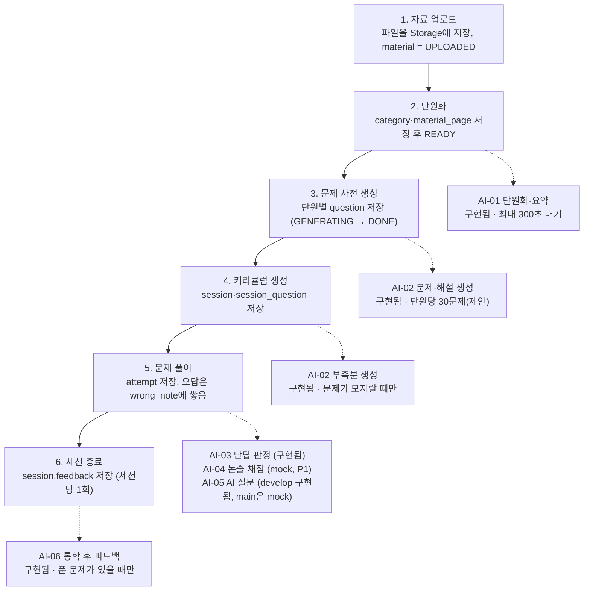

# AI 서버 ↔ 백엔드 API 명세

최종 수정: 2026-11-06 · 관련 문서: [백엔드 개발 명세서](./백엔드_개발_명세서.md)

## 0. 읽는 법

백엔드가 AI 서버를 호출하는 방법을 정한 문서다. 기준은 `commute-study-ai` 레포의 `docs/API_명세.md` **v0.3**(AI-02 시간 상한 55초/백엔드 60초 통일, AI-05 구현 완료, 사전 생성 40문제 반영)이다. 정확한 `develop` 커밋 해시는 `#18`에서 AI 담당에게 확인 요청 중이다. 문서와 코드가 다른 곳은 **코드를 따랐다**. AI 서버 레포의 명세는 "합의 전 초안"이라, 이 문서가 백엔드 쪽 정리본이고 합의는 12장에서 끝낸다.

### 상태 표기

| 표기 | 의미 |
| --- | --- |
| **구현됨** | AI 서버 코드에 실제 구현되어 있고 이 문서가 코드와 같다. 백엔드는 이 형식에 맞춘다. `AI_MOCK=false`일 때 실제 AI를 쓴다 |
| **mock** | 형식만 정해져 있고 항상 고정 응답을 돌려준다. 실제 구현 전이라 형식이 바뀔 수 있다 (AI-04, AI-05) |
| **합의 필요** | AI 담당과 정해야 한다. 항목은 12장에 모았고 각 장에서 `합의 #번호`로 가리킨다. 결정 칸이 비어 있는 동안 이 문서의 값은 임시다 |
| **백엔드 결정** | 백엔드 내부에서 정하면 되는 것. AI 담당에게는 알려만 준다 |

### AI 서버 자체 문서와의 관계

- 요청·응답 필드는 AI 서버 코드가 가진 그대로 적었다. 요청은 모르는 필드를 **400으로 거부**하므로(`extra=forbid`) 백엔드가 임의로 필드를 더 보내면 안 된다.
- 백엔드 개발 명세서 8장은 이 문서를 가리키고, 백엔드 쪽 처리(저장·상태 전이·재시도)만 다룬다.

## 1. 공통 규칙

| 항목 | 내용 | 상태 |
| --- | --- | --- |
| 호출 주체 | 백엔드만 호출한다. 앱은 AI 서버를 직접 호출하지 않는다 | 구현됨 |
| 주소 | `http://commute-study-ai.railway.internal:8000` (Railway 내부망, 포트 포함). 백엔드 환경변수 `AI_SERVER_URL` | 구현됨. 로컬 접속은 합의 #10 |
| 인증 | 모든 `/v1` 요청에 `X-Internal-Key` 헤더. 값은 양쪽의 `AI_INTERNAL_KEY`가 같아야 한다. 틀리면 401 `UNAUTHORIZED`. `/health`는 키가 없다 | 구현됨 |
| 메서드·형식 | `/v1`은 전부 POST, `Content-Type: application/json`, UTF-8. 필드이름은 camelCase. AI-05만 응답이 `text/event-stream` | 구현됨 |
| 모르는 필드 | 요청에 정의되지 않은 필드를 보내면 400 `INVALID_REQUEST`. 응답에는 백엔드가 모르는 필드가 늘 수 있으니 무시한다 | 구현됨. 변경 절차는 합의 #11 |
| 상태 | AI 서버에는 DB가 없다. 필요한 내용(자료 쪽 텍스트, 이전 대화 등)을 매 요청에 담아 보내고, 저장은 백엔드가 한다 | 구현됨 |
| mock | `AI_MOCK=true`(기본)이면 고정 응답. 실패를 시험하려면 `X-Mock-Error: <에러 코드>` 헤더를 보낸다. `AI_MOCK=false`이면 이 헤더는 무시된다 | 구현됨. mock 확장은 합의 #12 |

### 백엔드가 지킬 호출 규칙

- 통신 실패·에러는 모두 `{"error":{"code","message"}}` 형태로 오니 한 곳에서 파싱해 백엔드 에러 코드로 바꾼다(3장).
- AI 호출을 DB 트랜잭션 안에 두지 않는다. `spring.jpa.open-in-view: false`를 설정해 AI 응답을 기다릴 동안 Supabase 커넥션을 붙잡지 않게 한다. (AI 레포 개발계획 6장 #6, 백엔드 결정)
- 긴 호출(AI-01, AI-02)은 별도 스레드(`@Async`)에서 동시에 최대 3개까지 실행한다. 합의 #2.
- 자료 원문(`pages`)과 `X-Internal-Key`는 로그에 남기지 않는다. 로그에는 기능 ID, 자료 ID, 에러 코드, 소요 시간, `meta`만 남긴다.

## 2. 호출 목록

서버 시간 상한은 백엔드 타임아웃보다 짧다. 그래야 백엔드가 연결을 끊기 전에 AI 서버가 에러나 부분 결과를 돌려줄 수 있다. AI 서버는 시간 상한에 닿으면 남은 재시도를 하지 않는다. 아래 시간 상한 중 AI-01\~03, AI-06은 코드의 상수와 같다(AI-04, AI-05는 문서 값).

| ID | 메서드·경로 | 호출 시점 | AI 서버 시도 | 서버 시간 상한(초) | 백엔드 타임아웃(초) | 상태 |
| --- | --- | --- | --- | --- | --- | --- |
| - | `GET /health` | 배포 확인 | - | - | 5 | 구현됨 |
| AI-01 | `POST /v1/materials/process` | 자료가 `PROCESSING`이 될 때(업로드 직후, 사용자 재시도) | 2회 | 270 | 300 | 구현됨 · 합의 #1, #3, #4 |
| AI-02 | `POST /v1/questions/generate` | 단원 `READY` 직후 단원별 미리 생성, 커리큘럼 생성 시 부족분 | 생성 1회 + 재생성 최대 2회 | 55 | 60(미리 생성·부족분 공통) | 구현됨 · 합의 #5, #14 (v0.3) |
| AI-03 | `POST /v1/answers/judge-short` | 단답이 정답 목록과 다를 때만 | 1회 | 4 | 5 | 구현됨 · 합의 #6 |
| AI-04 | `POST /v1/answers/grade-essay` (P1) | 논술 답안 제출 시, 실패한 답안은 세션 종료 때 1회 | 1회 | 18 | 20 | mock · 합의 #8 |
| AI-05 | `POST /v1/tutor/ask` (SSE) | AI 질문 버튼·입력 시 | 1회 | 13 | 15 | **구현됨(AI 서버 `develop`, 11/5)**. Railway `main`엔 아직 mock만 배포 · 합의 #9 해소 |
| AI-06 | `POST /v1/sessions/feedback` | 세션이 `COMPLETED` 또는 `ENDED`가 된 직후 | 1회 | 13 | 15 | 구현됨 · 합의 #7 |

- AI-02는 v0.3부터 미리 생성·부족분 모두 서버 시간 상한 55초(백엔드 타임아웃 60초)로 같다(이전 80초·300/90초 구분은 폐기). 55초 안에 다 만들지 못한 몫은 응답의 `shortfall`로 돌아오고, 백엔드가 커리큘럼 생성 때 부족분으로 다시 요청한다.
- 백엔드는 연결 시작부터 응답 끝까지의 전체 시간에 위 백엔드 타임아웃을 건다. 값은 설정값으로 두고, 시간이 또 바뀌면 이 표만 고친다. 시도 횟수·시간 상한의 최종 합의는 합의 #15.
- 백엔드 명세서 8장의 이전 지연 목표(AI-01 30\~90초, AI-02 60\~180초 등)는 기능명세서 5장의 기획 목표였고, 실제 호출 제한은 위 표를 따른다.

## 3. 에러 응답

실패는 항상 아래 한 가지 형태다. `message`는 사용자에게 그대로 보여줄 수 있는 문장이다. (AI-05는 스트림 도중 실패하면 `event: error`에 같은 형태를 담는다.)

```json
{ "error": { "code": "TEXT_EXTRACTION_FAILED", "message": "글자를 인식하지 못했어요. 글자가 선명한 파일로 다시 올려주세요." } }
```

| HTTP | code | 의미 | 백엔드 처리 | 상태 |
| --- | --- | --- | --- | --- |
| 400 | `INVALID_REQUEST` | 요청 형식 오류·모르는 필드·허용하지 않은 파일 주소. `message`에 문제의 위치가 들어 있다 | 호출 코드 버그로 보고 로그만 남기며 사용자에게는 `INTERNAL_ERROR` | 구현됨 |
| 401 | `UNAUTHORIZED` | `X-Internal-Key`가 틀림 | 환경변수를 확인하고 사용자에게는 `AI_UNAVAILABLE` | 구현됨 |
| 422 | `UNSUPPORTED_FILE` | 열 수 없거나 지원하지 않는 파일(구버전 .ppt도 해당), 파일 30MB 초과 | 자료 `FAILED`, 재시도 무의미 | 구현됨 |
| 422 | `PAGE_LIMIT_EXCEEDED` | PDF·PPT 100쪽, PNG 20장 초과 | 자료 `FAILED` | 구현됨 |
| 422 | `TEXT_EXTRACTION_FAILED` | 텍스트 인식 실패(전체 글자가 200자 미만) | 자료 `FAILED`, 재시도 무의미 | 구현됨 |
| 502 | `FILE_FETCH_FAILED` | 파일 URL 다운로드 실패 | 서명 URL을 새로 만들어 1회 다시 호출, 또 실패하면 `FAILED` | 구현됨 · 합의 #1 |
| 502 | `LLM_FAILED` | AI 응답 오류. 시도 횟수를 다 쓴 뒤 반환 | 기능별 실패 처리(아래 표) | 구현됨 |
| 504 | `LLM_TIMEOUT` | 서버 시간 상한 초과 | 기능별 실패 처리(아래 표) | 구현됨 |

### 백엔드가 자체적으로 만드는 실패

| 상황 | 백엔드 처리 |
| --- | --- |
| 백엔드 타임아웃(1장 표의 시간)을 넘김 | `LLM_TIMEOUT`과 같은 처리. 사용자 API는 `AI_TIMEOUT`(504) |
| 연결 실패, 그 외 5xx | `LLM_FAILED`와 같은 처리. 사용자 API는 `AI_UNAVAILABLE`(502) |

### 기능별 실패 처리 (`LLM_FAILED`, `LLM_TIMEOUT`, 백엔드 타임아웃)

| 기능 | 처리 |
| --- | --- |
| AI-01 | 자료 `FAILED`, `message`를 `material.error_message`에 저장하고 사용자가 다시 시도하면 같은 파일로 1회 다시 호출(M5) |
| AI-02 미리 생성 | 자료는 `READY`로 둔다. 단원의 문제 생성 상태만 실패로 표시하고 다음 커리큘럼 생성 때 부족분으로 다시 호출 |
| AI-02 부족분 | 있는 문제로만 커리큘럼을 만든다. 문제가 0개이면 커리큘럼을 만들지 않고 실패를 안내해 사용자가 다시 시도하게 한다 |
| AI-03 | 재시도 없이 자가 판정으로 넘긴다. 사용자 API는 `{correct: null, timeout: true}`(200) |
| AI-04 | "나중에 확인"으로 저장(`attempt.correct`는 null), 세션 종료 때 1회 재호출, 또 실패하면 채점 대기 |
| AI-05 | 나온 내용은 남기고 재시도 버튼을 표시. **횟수를 차감하지 않는다**(`done`을 받았을 때만 차감) |
| AI-06 | 재시도 없이 피드백 없는 숫자 카드만 표시 (`feedback: null`) |

## 4. 공통 타입과 값 매핑

```text
Page       { page: int(1 이상), text: string }
UsageMeta  { model: string, inputTokens: int, outputTokens: int, elapsedMs: int, attempts: int }
```

`UsageMeta`는 AI-01, AI-02 응답과 AI-05의 `done` 이벤트에 들어 있다. 비용·지연 집계는 AI 서버 로그가 하므로 백엔드는 DB에 저장하지 않고 소요 시간만 로그에 남긴다.

### 값 매핑 (AI 서버 ↔ 백엔드 DB)

| JSON 필드 | 값 | 백엔드 DB (`V1__init_schema.sql`) |
| --- | --- | --- |
| `fileType` | `PDF` / `PPT` / `PNG` | `material_file_type` 열거형 |
| `kind` | `LECTURE` / `PAST_EXAM` | `material_kind` |
| `type` | `OX` / `MC` / `SHORT` / `ESSAY` | `question_type` |
| `difficulty` | 1(하), 2(중), 3(상) | `question.difficulty` int |
| `mode` | `CURRICULUM` / `REVIEW` | `session_mode` |
| `materialId`, `categoryId`, `sessionId` | 숫자(bigint) | `material.id`, `category.id`, `session.id` |

모두 대문자 열거형이고 DB의 열거형 값과 그대로 같다. 백엔드는 변환 없이 그대로 주고받는다.

### 쪽 번호

- PDF는 뷰어 기준 1부터, PPT는 슬라이드 번호, PNG는 `fileUrls` 배열 순서(1부터)를 쓴다.
- PPT는 `.pptx`만 처리한다. 구버전 `.ppt`는 `UNSUPPORTED_FILE`이므로 백엔드 업로드 단계에서 `.pptx`만 받는다.
- 슬라이드 속 이미지의 글자는 읽지 않는다(MVP).

### AI 서버가 보장하는 값 (코드 상수, DB 컬럼 크기 참고)

| 항목 | 보장 |
| --- | --- |
| 단원 | 1\~20개, 1쪽부터 마지막 쪽까지 빠짐없이 겹치지 않게, `summary` 1500자 이내. **`summary`는 마크다운**(불릿 `-`, 줄바꿈 `\n`)이라 프론트가 그대로 렌더링한다. 백엔드는 가공하지 않고 저장·전달만 한다 |
| 문제 | `stem` 300자 이내, `explanation` 600자 이내, `conceptTags` 3개 이하(각 20자 이내) |
| 단답형 | 대표 정답 20자 이내, `acceptedAnswers` 5개 이하 |
| 객관식 | 선택지 4개, `answer`는 `"1"`\~`"4"` |
| O/X | `answer`는 `"O"` 또는 `"X"` |

## 5. AI-01 단원화·요약본 생성

`POST /v1/materials/process` · 상태 **구현됨** · 합의 필요 #1(서명 URL), #3(PNG 여러 장), #4(족보)

자료가 `PROCESSING`이 될 때 호출한다. AI 서버가 파일을 직접 내려받아 텍스트를 추출하고(스캔 쪽은 OCR) 단원으로 나눠 요약한다. 백엔드는 파일을 열지 않는다. 이 호출은 동기 HTTP이고 최대 300초까지 기다린다. 그래서 업로드 API는 즉시 응답하고 별도 스레드에서 부른다. AI 서버는 진행률을 주지 않으므로 상태 API는 `PROCESSING`/`READY`/`FAILED`만 알려준다.

### 요청

```json
{
  "materialId": 123,
  "fileType": "PDF",
  "kind": "LECTURE",
  "fileName": "자료구조_3주차.pdf",
  "fileUrls": ["https://<project>.supabase.co/storage/v1/object/sign/..."]
}
```

| 필드 | 타입 | 규칙 | 백엔드 값 |
| --- | --- | --- | --- |
| `materialId` | int | 필수 | `material.id` |
| `fileType` | `PDF`/`PPT`/`PNG` | 필수 | `material.file_type` |
| `kind` | `LECTURE`/`PAST_EXAM` | 필수. 족보도 MVP에서는 같이 단원화한다(합의 #4) | `material.kind` |
| `fileName` | string | 필수. AI 서버는 쓰지 않지만 빠지면 400. V1에 파일명 컬럼이 없어 V2에서 `material.file_name`을 추가하거나 Storage 경로에서 만든다(백엔드 결정) | 업로드 원본 파일명 |
| `fileUrls` | URL 1\~20개 | PDF·PPT는 정확히 1개, PNG는 1\~20개를 쪽 순서대로(합의 #3). Supabase **서명 URL**이어야 하고 호스트가 AI 서버의 `SUPABASE_HOST`와 같아야 한다. 리다이렉트는 따라가지 않는다 | 호출 직전에 만든 서명 URL(유효시간 10분 제안, 합의 #1) |

### AI 서버의 처리와 한계

- 파일당 30MB를 넘으면 `UNSUPPORTED_FILE`이다. 다운로드 제한시간은 30초다. 백엔드도 업로드 단계에서 30MB를 막는다.
- 쪽수(PDF·PPT 100쪽, PNG 20장)는 파일을 열어야 알 수 있어 **AI 서버가 판단**하고 `PAGE_LIMIT_EXCEEDED`로 돌려준다.
- 텍스트가 없는 쪽만 OCR한다. PPT 슬라이드 속 이미지의 글자는 읽지 않는다. 전체 글자가 200자를 넘지 못하면 `TEXT_EXTRACTION_FAILED`다.

### 응답 200

```json
{
  "pageCount": 2,
  "pages": [
    { "page": 1, "text": "스택은 나중에 넣은 데이터가 먼저 나오는 구조다." },
    { "page": 2, "text": "큐는 먼저 넣은 데이터가 먼저 나오는 구조다." }
  ],
  "categories": [
    { "order": 1, "name": "스택과 큐", "pageStart": 1, "pageEnd": 2, "summary": "- 스택은 LIFO 구조예요. (1쪽)\n- 큐는 FIFO 구조예요. (2쪽)" }
  ],
  "meta": { "model": "mock", "inputTokens": 0, "outputTokens": 0, "elapsedMs": 0, "attempts": 1 }
}
```

| 응답 필드 | 백엔드 저장 |
| --- | --- |
| `pageCount` | `material.page_count` |
| `pages[]` (`page`, `text`) | **반드시 저장**. AI-02와 AI-05의 입력으로 다시 쓰인다. V1에 없어 V2 `material_page(material_id, page, text)`가 필요하다 |
| `categories[]` | `category`. `order`→`order`, `pageStart`→`page_start`, `pageEnd`→`page_end`, `summary`→`summary`, `name`→`name`, `category.material_id`는 요청의 `materialId` |
| `meta` | 저장하지 않고 소요 시간만 로그 |
| 에러 `message` | `material.error_message` |

`categories`는 1쪽부터 마지막 쪽까지 빠짐없이, 겹치지 않게 이어진다. AI 서버가 검증하고 보정한 뒤 반환하므로 백엔드는 `pageStart ≤ pageEnd ≤ pageCount`만 방어적으로 확인한다. 저장은 한 트랜잭션으로 하고 AI 호출은 트랜잭션 밖에서 한다.

### 백엔드 상태 전이 (백엔드 개발 명세서 6장 자료 처리 상태)

| 결과 | 전이 |
| --- | --- |
| 200 | `PROCESSING` → `READY`(M3). `category`와 `material_page`를 저장한 뒤 `READY`로 바꾸고, 그 다음 단원별 AI-02 사전 생성을 시작한다 |
| `UNSUPPORTED_FILE`, `PAGE_LIMIT_EXCEEDED`, `TEXT_EXTRACTION_FAILED`, `LLM_FAILED`, `LLM_TIMEOUT`, 백엔드 타임아웃 | `PROCESSING` → `FAILED`(M4). `message`를 `error_message`에 저장해 사용자에게 보여준다 |
| `FILE_FETCH_FAILED` | 서명 URL을 새로 만들어 1회 다시 호출. 또 실패하면 M4 |
| 사용자 재시도 | `FAILED` → `PROCESSING`(M5). 같은 파일로 1회 다시 호출 |
| 서버 재시작으로 호출이 끊김 | `PROCESSING`이 10분을 넘으면 `FAILED`로 정리(백엔드 처리) |

업로드 이슈의 완료 조건도 이에 맞춘다. 백엔드는 형식(`.pdf`, `.pptx`, `.png`)과 30MB만 막고 쪽수 초과는 `FAILED`의 `error_message`로 알린다.

### mock 동작

mock 응답은 파일과 상관없이 항상 위 예시(2쪽, 단원 1개)다. mock에서는 업로드한 파일의 실제 쪽수와 다를 수 있으니 백엔드는 `pageCount`를 응답 그대로 저장하고 파일과 비교하지 않는다.

## 6. AI-02 문제·해설 생성

`POST /v1/questions/generate` · 상태 **구현됨** · 합의 #5(사전 생성 규모) 해소(40문제 확정) · 합의 필요 #14(요청 크기)

단원 하나의 문제와 해설을 만든다. 해설은 문제와 함께 미리 만든다(LN-05). 사용자가 풀 때는 추가 AI 호출이 없다. 호출 시점은 두 가지다.

- **미리 생성**: 단원이 생기면(자료 `READY` 직후) 단원별로 1회. 백엔드 개발 명세서 기준 중 난이도 **40문제(O/X 14, 객관식 13, 단답 13)**로 확정했다(이전 30문제·10/15/5는 폐기).
- **부족분**: 커리큘럼 생성 때 필요한 유형·난이도·개수가 모자라면 모자라는 만큼만 요청한다. 상·하 난이도도 여기서 요청한다.

### 요청

```json
{
  "category": {
    "categoryId": 1,
    "name": "스택과 큐",
    "pages": [
      { "page": 1, "text": "스택은 나중에 넣은 데이터가 먼저 나오는 구조다." },
      { "page": 2, "text": "큐는 먼저 넣은 데이터가 먼저 나오는 구조다." }
    ]
  },
  "requests": [
    { "type": "OX", "difficulty": 2, "count": 14 },
    { "type": "MC", "difficulty": 2, "count": 13 },
    { "type": "SHORT", "difficulty": 2, "count": 13 }
  ],
  "excludeStems": ["스택의 입출력 방식은?"]
}
```

| 필드 | 규칙 | 백엔드 값 |
| --- | --- | --- |
| `category.categoryId`, `name` | 필수 | `category.id`, `category.name` |
| `category.pages[]` | 1개 이상. 그 단원의 쪽 범위(`page_start`\~`page_end`) 텍스트만 보낸다 | `material_page`에서 쪽 범위로 조회 |
| `requests[]` | 1개 이상. `type`, `difficulty`(1\~3), `count`(1 이상). **`count` 합계 40 이하**, 넘으면 400 `INVALID_REQUEST` | 백엔드가 40 단위로 나눠 부른다 |
| `excludeStems` | 이미 있는 문제의 지문(기본 빈 배열). AI 서버는 이 중 **최근 60개만** 참조한다 | 같은 단원의 `question.stem`(최근 60개만 보내도 된다) |

### 응답 200

```json
{
  "questions": [
    {
      "type": "MC",
      "difficulty": 2,
      "stem": "다음 중 FIFO 구조는?",
      "choices": ["스택", "큐", "트리", "그래프"],
      "answer": "2",
      "acceptedAnswers": [],
      "rubric": [],
      "explanation": "큐는 먼저 넣은 데이터가 먼저 나오는 FIFO 구조다.",
      "sourcePage": 2,
      "evidenceQuote": "큐는 먼저 넣은 데이터가 먼저 나오는 구조다.",
      "conceptTags": ["큐", "FIFO"]
    }
  ],
  "shortfall": [ { "type": "SHORT", "difficulty": 2, "count": 1 } ],
  "rejected": { "schema": 1, "evidence": 2, "duplicate": 0 },
  "meta": { "model": "gpt-6.1-terra", "inputTokens": 5000, "outputTokens": 9000, "elapsedMs": 95000, "attempts": 2 }
}
```

| 유형 | `choices` | `answer` | `acceptedAnswers` | `rubric` |
| --- | --- | --- | --- | --- |
| `OX` | `[]` | `"O"` 또는 `"X"` | `[]` | `[]` |
| `MC` | 4개 | 정답 번호 `"1"`\~`"4"` | `[]` | `[]` |
| `SHORT` | `[]` | 대표 정답 | 표기 변형을 포함한 정답 목록 | `[]` |
| `ESSAY` | `[]` | `""` | `[]` | 채점용 핵심 포인트 3\~5개 |

### AI 서버의 동작

- 서버 안에서 형식 오류, 자료에 근거가 없는(`evidence`) 문제, 중복 문제를 버리고 부족분만 최대 2회 다시 만든다(총 3라운드). 탈락을 예상해 요청보다 20% 더 만들고, 한 번에 최대 10문제씩 나눠 동시에 부른다.
- 시간 상한 80초. 남은 시간이 20초 미만이면 다시 만들지 않는다.
- 다 못 만들어도 있는 문제와 `shortfall`을 **200**으로 돌려준다. 문제가 0개이면 502 `LLM_FAILED`다.
- `rejected`는 탈락 건수 통계다. 백엔드는 로그만 남긴다.
- mock은 요청한 유형·난이도·개수만큼 지문이 `[mock N] ...`인 문제를 만들어 돌려주고 `shortfall`은 항상 비어 있다. 부족분 흐름을 시험하려면 합의 #12가 필요하다.

### 백엔드 저장 (`question`)

| 응답 필드 | 저장 |
| --- | --- |
| `type`, `difficulty`, `stem`, `explanation` | 같은 이름의 컬럼 |
| `choices`, `acceptedAnswers` | `choices`, `accepted_answers` (jsonb) |
| `answer` | `answer` |
| `rubric` | `rubric` — V1은 `text`라 V2에서 `jsonb`로 바꾼다(목록이므로) |
| `sourcePage` | `source_page` |
| `conceptTags` | V2 `question.concept_tags jsonb` — AI-06 피드백 입력에 쓴다 |
| `evidenceQuote` | 저장하지 않는다(백엔드 결정). 필요하면 나중에 추가 |
| `category_id` | 요청의 `categoryId` |

저장 전에 `sourcePage`가 그 단원의 쪽 범위 안인지 방어적으로 확인한다. 벗어나면 저장하지 않는다.

### 백엔드 호출 규칙

- 단원 문제 생성 상태를 `GENERATING` / `DONE` / `FAILED`로 둔다(V2 `category.question_status`, 백엔드 결정). 미리 생성이 **진행 중(`GENERATING`)인 단원에는 부족분을 요청하지 않는다.** 같은 문제를 중복으로 만들게 된다.
- 단원·난이도별 문제가 **60개**가 되면 더 생성하지 않고 이미 나온 문제를 다시 낸다. 이 상한은 백엔드가 확인한다.
- 미리 생성 실패는 자료를 `READY`로 두고 단원 상태만 `FAILED`로 둔다. 다음 커리큘럼 생성 때 부족분으로 다시 호출한다.
- 호출은 단원별로 나눠 `@Async` 동시 3개까지 한다(합의 #2).

## 7. AI-03 단답형 판정

`POST /v1/answers/judge-short` · 상태 **구현됨** · 합의 필요 #6(시간 기준, 정규화 일치)

백엔드가 공백·대소문자를 정규화해 `acceptedAnswers`와 먼저 비교하고, **일치하지 않을 때만** 호출한다.

### 요청

```json
{
  "stem": "먼저 넣은 데이터가 먼저 나오는 자료구조는?",
  "acceptedAnswers": ["큐", "Queue"],
  "explanation": "큐는 FIFO 구조다.",
  "userAnswer": "대기열"
}
```

| 필드 | 규칙 | 백엔드 값 |
| --- | --- | --- |
| `stem` | 필수 | `question.stem` |
| `acceptedAnswers` | 1개 이상 | `question.accepted_answers` |
| `explanation` | 필수 | `question.explanation` |
| `userAnswer` | 필수. AI 서버는 앞 200자만 쓴다. 앱의 입력 제한은 30자다 | 사용자가 입력한 답 |

### 응답 200

```json
{ "correct": true, "reason": "큐를 뜻하는 다른 표현이에요." }
```

### 동작과 백엔드 처리

- AI 서버는 답이 비어 있으면 AI를 부르지 않고 `correct: false`로 돌려준다. 백엔드가 비교한 뒤에도 정규화 기준이 다를 수 있어 서버가 한 번 더 비교한다. AI 서버의 정규화는 **유니코드 NFKC 정규화 후 소문자, 공백과 문장부호 제거**다. 백엔드도 같은 규칙을 써야 AI 호출을 아낄 수 있다(합의 #6).
- 시도 1회, 서버 시간 상한 4초, 백엔드 타임아웃 5초다. 실패하면 재시도하지 않는다.
- 실패하거나 시간이 넘으면 사용자 API는 `{correct: null, timeout: true}`를 돌려준다. 앱은 대표 정답을 보여주고 자가 판정 화면을 띄운다. 자가 판정 결과도 정답률에 포함하고, 자가 판정 여부는 응답 기록에 함께 저장한다(V2 `attempt.self_judged boolean`).
- 이 호출은 판정만 하고 답안 저장은 하지 않는다. 저장은 `POST /attempts`가 맡는다.
- mock은 항상 위 응답 예시(`correct: true`)를 돌려준다.

### 시간 기준이 어긋난다 (합의 #6)

기능명세서 LN-03은 "판정 중 스피너 최대 3초, 초과하면 정답을 공개하고 자가 판정"이다. AI 서버 상한은 4초이고 백엔드 타임아웃은 5초라, 사용자가 3초보다 오래 기다릴 수 있다. 제안은 백엔드 타임아웃을 3초로 줄이고, AI 서버 상한도 3초로 맞추는 것이다.

## 8. AI-04 논술형 채점 (P1)

`POST /v1/answers/grade-essay` · 상태 **mock** · 합의 필요 #8

AI 서버에서 실제로 구현되어 있지 않다. `AI_MOCK=false`여도 항상 고정 응답을 돌려준다(코드에 실제 처리 없음). 형식은 아래 예시와 같지만 실제 구현 전이라 바뀔 수 있다. 개발계획에서 일정이 빠듯하면 가장 먼저 절삭하는 기능이다.

### 요청

```json
{
  "stem": "스택과 큐의 차이를 설명하시오.",
  "rubric": ["스택은 LIFO", "큐는 FIFO", "활용 사례"],
  "explanation": "...",
  "userAnswer": "스택은 나중에 넣은 게 먼저 나오고 큐는 반대다."
}
```

| 필드 | 규칙 | 백엔드 값 |
| --- | --- | --- |
| `stem` | 필수 | `question.stem` |
| `rubric` | 1개 이상의 문자열 목록 | `question.rubric` (V2 jsonb) |
| `explanation` | 필수 | `question.explanation` |
| `userAnswer` | 필수. 앱의 입력 제한은 300자 | 사용자 답안 |

### 응답 200

```json
{
  "correct": true,
  "score": 0.67,
  "points": [
    { "point": "스택은 LIFO", "met": true, "reason": "동작을 정확히 설명했어요." },
    { "point": "큐는 FIFO", "met": true, "reason": "반대라고 설명했어요." },
    { "point": "활용 사례", "met": false, "reason": "사례가 없어요." }
  ],
  "feedback": "두 구조의 차이는 맞게 설명했어요. 활용 사례를 덧붙이면 좋아요."
}
```

- `score`는 충족한 핵심 포인트의 **비율**(0\~1)이다. `correct`는 `score`가 0.6 이상이면 `true`다.
- 시도 1회, 서버 시간 상한 18초, 백엔드 타임아웃 20초다.

### 백엔드 처리

| 상황 | 처리 |
| --- | --- |
| 성공 | `attempt.score`에 `score`, `attempt.correct`에 `correct`를 저장. `points`와 `feedback`은 저장할 컨럼이 없어 사용자 API 응답으로만 내려준다(나중에 다시 보여야 하면 컨럼 추가 필요) |
| 실패·시간 초과 | "나중에 확인"으로 저장하고 `attempt.correct`는 null로 둔다. 세션 종료 때 백엔드가 1회 다시 호출한다. 또 실패하면 채점 대기로 둔다 |
| 채점 대기 | null이므로 정답률에서 제외하고, AI-06의 `answered`, `correct`에도 넣지 않는다. AI-06은 재채점을 기다리지 않고 채점 전 답안을 빼고 호출한다 |

### 합의가 필요한 점 (#8)

- 실제 구현 시점과 백엔드가 이 기능을 넣을지(논술형 MVP 포함 여부는 기능명세서에서 논의 중).
- 요청에 **자료 원문이 없다**. 기능명세서는 "자료 근거로만 피드백"이라 rubric와 해설만으로 충분한지 확인해야 한다.
- 응답 형식이 이전 백엔드 설계(`score`/`max`/`items`)와 다르다. 백엔드 사용자 API를 AI 응답(`score` 비율, `points`)에 맞춘다.
- 같은 답안을 다시 채점하면 점수가 같아야 한다(세션 종료 시 재채점이 있으므로).

## 9. AI-05 AI 질문 (SSE, P0)

`POST /v1/tutor/ask` · 응답 `text/event-stream` · 상태 **구현됨(AI 서버 `develop`, 11/5)**, Railway `main`은 아직 mock · 합의 #9 해소

`AI_MOCK=true`일 때는 고정 답변을 공백 단위 조각(`delta`)으로 나눠 0.05초 간격으로 보내고 `done`으로 끝낸다. `main`에 실제 모드가 배포되기 전까지는 백엔드도 mock으로만 연동을 확인할 수 있다.

### 요청

```json
{
  "category": {
    "categoryId": 1,
    "name": "스택과 큐",
    "pages": [{ "page": 1, "text": "..." }]
  },
  "question": {
    "stem": "다음 중 FIFO 구조는?",
    "choices": ["스택", "큐", "트리", "그래프"],
    "answer": "2",
    "explanation": "...",
    "userAnswer": "1"
  },
  "history": [
    { "role": "user", "content": "왜 스택은 아니에요?" },
    { "role": "assistant", "content": "스택은 ..." }
  ],
  "message": "그럼 큐는 어디에 써요?"
}
```

| 필드 | 규칙 | 백엔드 값 |
| --- | --- | --- |
| `category` | `categoryId`, `name`, `pages[]`(1개 이상) | 문제가 속한 단원과 `material_page`의 그 단원 쪽 |
| `question` | `stem`, `answer`, `explanation` 필수, `choices` 기본 `[]`, `userAnswer` 기본 `""` | `question` 행 + 사용자가 고른 답 |
| `history` | `role`(`user`/`assistant`)와 `content`. **최대 6개**(최근 3왕복), 없으면 빈 배열 | 백엔드 또는 앱이 보관(합의 #9) |
| `message` | 1자 이상. 꼬리질문 버튼은 고정 문구(왜 틀렸어? / 예시 더 / 쉽은 말로)를 이 필드로 보낸다. 자유 질문과 호출 방식이 같다 | 사용자 입력 또는 버튼 고정 문구 |

### 응답 (SSE 이벤트)

```text
event: delta
data: {"text":"큐는 "}

event: delta
data: {"text":"대기열 처리에 써요."}

event: done
data: {"meta":{"model":"...","inputTokens":5000,"outputTokens":120,"elapsedMs":3100,"attempts":1}}
```

- 실패하면 `event: error`에 3장의 공통 에러 형태를 담아 보낸다(mock은 첫 조각 뒤에 끊는다). `delta` 뒤에 `error`가 오면 나온 내용을 남기고 다시 시도 버튼을 표시한다.
- 답변은 단원 자료를 기준으로 하고 자료에 없는 내용은 없다고 밝힌다(목표). 시도 1회, 서버 시간 상한 13초, 백엔드 타임아웃 15초다. 기능명세서는 첫 글자 2초 이내를 요구한다.

### 백엔드 처리

- **횟수 제한은 백엔드가 관리한다**(`ai_question_usage`). 하루 **20회**(꼬리질문과 추가 질문 합산, 한국 시간 자정 초기화)로 양쪽 문서가 일치한다(합의 #9 해소). AI 서버는 횟수를 세지 않으므로 동작은 바뀌지 않는다.
- **`done` 이벤트를 받았을 때만 차감**한다. 실패하면 차감하지 않는다.
- **사용자당 진행 중인 질문은 1개**로 제한한다. 동시 요청으로 한도를 넘기거나, `done`을 못 받은 호출이 겹쳐 쌓이는 것을 막는다. 진행 중에 새 요청이 오면 409로 거부한다(제안).
- **SSE 중계**: Spring MVC에서 `SseEmitter`로 AI 서버 스트림을 앱에 그대로 전달한다. Railway에서 버퍼링 없이 지나가는지 측정해야 한다(AI 개발계획 V6, 현재는 미확인).

### 합의가 필요한 점 (#9)

- 실제 구현 시점(P1)과 첫 글자 2초 이내 목표가 스트리밍으로 가능한지 Railway에서 확인.
- 하루 한도 10회(AI 서버 문서는 20회).
- `history`를 누가 보관할지. 백엔드에 질문·답변 저장 테이블이 없어 앱이 최근 3왕복을 들고 있다가 보내는 방식을 제안한다.
- `message` 최대 길이. AI 스키마에 상한이 없어 백엔드가 상한을 둘지 정한다.
- 동시 1개 제한이 실패한 요청의 재시도에도 적용되는지.

## 10. AI-06 통학 후 피드백

`POST /v1/sessions/feedback` · 상태 **구현됨** · 합의 필요 #7(지난 정답률)

### 요청

```json
{
  "sessionId": 1,
  "mode": "CURRICULUM",
  "total": 15,
  "answered": 15,
  "correct": 12,
  "correctConcepts": ["스택", "큐"],
  "wrongItems": [
    { "stem": "다음 중 FIFO 구조는?", "conceptTags": ["FIFO"] }
  ]
}
```

| 필드 | 규칙 | 백엔드 값 |
| --- | --- | --- |
| `sessionId` | 필수 | `session.id` |
| `mode` | `CURRICULUM` / `REVIEW` | `session.mode` |
| `total` | 0 이상 | 세션의 문제 수(`session_question`) |
| `answered` | 0 이상. **0이면 400** | 응답한 문제 수(채점 대기 제외) |
| `correct` | 0 이상 | 정답 수(자가 판정 포함, 채점 대기 제외) |
| `correctConcepts` | 기본 `[]` | 맞힌 문제들의 `concept_tags` 모음 |
| `wrongItems[]` | `stem`, `conceptTags`(기본 `[]`). AI 서버는 앞 20개만, 지문은 앞 100자만 쓴다 | 틀린 문제의 `stem`, `concept_tags` |

### 응답 200

```json
{ "feedback": "스택과 큐의 기본 개념은 잘 이해했어요. FIFO가 헷갈렸으니 다음에 다시 풀어보면 좋아요." }
```

### 호출 조건과 처리

- 세션이 `COMPLETED` 또는 `ENDED`가 된 직후에 호출한다. **`answered`가 0이거나 "새로 시작"으로 끝난 세션은 호출하지 않는다.** 사용자가 통학 후 요약(S-50)을 보지 않기 때문이다.
- 시도 1회, 서버 시간 상한 13초, 백엔드 타임아웃 15초다. 실패하면 재시도 없이 숫자 카드만 보여준다(`feedback: null`).
- 세션당 최대 1회만 호출하고 생성된 피드백은 저장해 이후 조회에서 재사용한다. V1에 저장할 컬럼이 없어 V2 `session.feedback text`를 제안한다(백엔드 결정).
- 개념 집계(상위 3개)는 AI 서버 코드가 하고 LLM에는 집계 결과만 넘긴다. 따라서 `conceptTags`가 비어 있으면 피드백이 약해진다. 백엔드는 문제 저장 시 `concept_tags`를 제대로 채워야 한다(이 필드는 AI-02 응답이 준다).
- mock은 항상 위 응답 예시 문장을 돌려준다.

### 합의가 필요한 점 (#7)

기능명세서 AI-06 입력에는 "지난 정답률"이 있고, RP-01 화면 예시는 "지난번보다 정답률이 12%p 올랐어요"다. 하지만 현재 요청에는 이전 정답률을 담을 필드가 없고, 요청은 모르는 필드를 400으로 거부하므로(`extra=forbid`) 백엔드가 임의로 보낼 수 없다. 제안: `previousAccuracy`(0\~1, 없으면 생략 또는 null)를 요청에 추가한다. 비교 대상(직전 완료 세션 vs 직전 일 평균)은 백엔드가 정하고 제안은 직전 완료 세션이다.

## 11. 백엔드가 저장해야 할 것

AI 서버는 DB가 없어서 응답을 백엔드가 모두 저장한다. AI를 부르는 시점과 그때 저장하는 대상은 아래와 같다.



각 API가 돌려준 필드를 어느 컬럼에 저장하는지는 5\~10장의 표에 있다. `meta`(토큰·소요 시간)는 저장하지 않고 소요 시간만 로그에 남긴다.

### V2 마이그레이션으로 필요한 변경 (백엔드 결정)

`V1__init_schema.sql`은 이미 적용돼 수정할 수 없다(Flyway 체크섬 불일치로 기동 실패). 변경은 V2 이후 파일로 하고, 마이그레이션은 5432(Session) 접속으로 실행한다.

| # | 변경 | 이유 | 비고 |
| --- | --- | --- | --- |
| 1 | `material_page(material_id, page, text)` 신규 | AI-01의 `pages`를 저장해 AI-02·AI-05 입력으로 다시 쓴다 | 필수, 가장 급함 |
| 2 | PNG 여러 장 저장 구조(`material_file` 신규 또는 `file_url`을 목록으로) | AI-01이 PNG 최대 20장을 한 자료로 받는다 | 합의 #3 결과에 따름 |
| 3 | `material.file_name` 추가 | AI-01 요청의 `fileName`이 필수 | Storage 경로에서 만들 수도 있음 |
| 4 | `category.question_status`(`GENERATING`/`DONE`/`FAILED`) | AI-02 사전 생성 중에는 부족분을 요청하지 않고, 실패하면 다시 요청한다 | 필수 |
| 5 | `question.concept_tags jsonb` | AI-02 응답을 저장해 AI-06 입력으로 쓴다 | 필수 |
| 6 | `question.rubric` text → jsonb | 논술형 채점 기준 목록 | P1 |
| 7 | `attempt.self_judged boolean` | AI-03 시간 초과 시 자가 판정 여부 |  |
| 8 | `session.feedback text` | AI-06 결과를 세션당 1회만 만들고 저장 |  |

V1에 이미 있어 바꿀 필요가 없는 것: `attempt.correct`가 null 허용(채점 대기), `question.difficulty` 정수, 열거형 값(AI 서버와 같음), `ai_question_usage`.

**반영 완료(`#10`, V2 마이그레이션, 11/4 머지)**: 위 1·3·4·5·7·8번은 실제로 적용됐다. 다만 4번은 이름이 `question_status`이고 값은 `GENERATING`/`DONE`/`FAILED`가 아니라 **`PREPARING`/`AVAILABLE`**로 바뀌었다(백엔드 개발 명세서 6장이 최종 기준). 6번(`rubric` jsonb 전환)은 논술형을 P2로 빼면서 **하지 않기로 했다** — `rubric`은 V1 그대로 `text`다. 2번(PNG 여러 장)은 합의 #3이 아직 안 끝나서 V2에 포함하지 않았고, 결정되면 별도 V 파일로 추가한다.

### 저장 규칙

- AI 호출은 DB 트랜잭션 밖에서 하고, 응답을 받은 뒤 저장만 한 트랜잭션으로 한다.
- 자료 단원화 결과(`category`, `material_page`, `page_count`)는 한 트랜잭션으로 저장한 뒤 `READY`로 바꾼다.
- 사용자 API는 AI 서버 응답을 그대로 노출하지 않고, 필요한 필드만 골라 내려준다.

## 12. AI 담당과 합의 필요 목록

우선은 **높음**이 AI 서버 연동 구현 전에 정해야 하는 것, 중간이 구현 중에 정해도 되는 것, 낮음이 P1이거나 나중에 정해도 되는 것이다. 상태 칸은 드롭다운이고, 결정 칸에 정한 값과 정한 사람을 적는다. 결정이 나면 해당 장의 값을 고친다. "현재 AI 서버"는 코드(`db9163d`)와 AI 서버 문서 기준이다.

| # | 항목 (관련 API) | 현재 AI 서버 | 백엔드 요구·제안 | 우선 | 상태 | 결정 |
| --- | --- | --- | --- | --- | --- | --- |
| 1 | 서명 URL 유효시간과 재서명 (AI-01) | Supabase 서명 URL 전달, 유효시간 10분 제안. 다운로드 실패(`FILE_FETCH_FAILED`)는 백엔드가 새 URL로 1회 재호출 | 동의 제안. 호출·재시도마다 새 서명 URL을 만든다. AI-01 최대 270초와 다운로드 30초를 감안하면 10분이면 충분 | 높음 | 합의 필요 |  |
| 2 | 긴 호출 방식과 동시 호출 수 (AI-01, AI-02) | 백엔드 `@Async` 스레드에서 동시 3개까지, AI-02는 단원별로 나눠 호출 제안 | 동의 제안. 동시 호출 수는 설정값으로 둔다 | 중간 | 합의 필요 |  |
| 3 | PNG 여러 장 처리 (AI-01) | 한 자료에 PNG 최대 20장을 `fileUrls` 배열로 받고 배열 순서가 쪽 번호. PDF·PPT는 정확히 1개 | V1은 `material.file_url` 1개라 구조 결정 필요. 제안: `material_file`로 한 자료에 여러 파일. 대안: PNG 1장을 자료 1개로 | 높음 | 합의 필요 |  |
| 4 | 족보·기출(`PAST_EXAM`) 처리 (AI-01, AI-02) | MVP에서는 강의자료와 같이 단원화. 족보로 문제를 만드는 방식은 미정 | 백엔드 이슈 #12는 "단원 목록에는 안 나오고 AI-02 참고용". (a) AI 문서대로 같이 단원화 (b) 족보는 AI-01을 부르지 않고 AI-02에 `referenceExamples` 필드를 추가 중 선택 | 중간 | 합의 필요 |  |
| 5 | AI-02 사전 생성 규모와 부족분 흐름 (AI-02) | v0.3 기준 시간 상한 55초(백엔드 60초)로 통일. `count` 합 40 이하 | 사전 생성 중인 단원에는 부족분을 호출하지 않고 단원·난이도별 60문제 상한은 백엔드가 지킨다 | 높음 | **해소** | 40문제(O/X 14, MC 13, SHORT 13), 중 난이도만 미리 생성 (`#10` V2 반영) |
| 6 | 단답 판정 시간 기준과 정규화 (AI-03) | 서버 상한 4초, 백엔드 타임아웃 5초. 정규화는 NFKC, 소문자, 공백·문장부호 제거 | 사용자 기준 3초(LN-03)에 맞춰 백엔드 타임아웃과 AI 상한을 3초로. 백엔드 정규화를 AI와 같게 맞춘다 | 높음 | 합의 필요 |  |
| 7 | 통학 후 피드백에 지난 정답률 추가 (AI-06) | 요청에 이전 정답률 필드가 없고 모르는 필드는 400 | `previousAccuracy`(0\~1, 선택) 추가. 기능명세서 RP-01 예시("지난번보다 12%p 올랐어요")에 필요 | 높음 | 합의 필요 |  |
| 8 | 논술형 채점 구현과 요청·응답 (AI-04, P1) | mock만 있음. 요청에 자료 원문이 없고 응답은 `score` 비율과 `points` | 구현 시점, 원문 입력 여부, 재채점 시 점수 일관성. 백엔드 사용자 API는 이 응답에 맞춘다 | 낮음 | 합의 필요 |  |
| 9 | AI 질문 SSE 중계·한도·history (AI-05) | **AI 서버 `develop`에 11/5 구현 완료**(P1→P0, Railway `main`은 아직 mock), `history` 최대 6개, 동시 1개 | `SseEmitter` 중계와 Railway 첫 글자 지연 측정은 실제 모드 배포 후 확인. `history` 보관은 앱, `message` 최대 길이는 백엔드가 정함 | 높음 | 부분 해소 | 하루 한도는 **20회**로 양쪽 문서 일치(백엔드 명세서 5장 확정). AI 서버 `main` 배포 시점은 AI 담당 몫 |
| 10 | 로컬 개발 접속과 환경변수 이름 (공통) | 내부 주소는 Railway 내부망에서만 열림. 환경변수 `AI_SERVER_URL`, `AI_INTERNAL_KEY` 제안 | 로컬은 AI 레포를 직접 실행(`AI_MOCK=true`)하거나 임시 공개 주소를 쓴다. Spring 키는 `ai.server-url`, `ai.internal-key`로 두고 `.env.example`에 추가 | 높음 | **해소** | `AI_SERVER_URL`, `AI_INTERNAL_KEY`로 확정, `.env.example`에 반영(`#18`) |
| 11 | API 변경 절차 (공통) | 요청이 `extra=forbid`라 필드가 어긋나면 바로 400 | 필드를 추가할 때는 AI 서버를 먼저 배포하고 백엔드를 배포. 변경은 이 문서에 날짜와 함께 기록 | 중간 | 합의 필요 |  |
| 12 | mock 시험 기능 확장 (공통) | `X-Mock-Error`만 지원. AI-01은 항상 2쪽·단원 1개, AI-02는 `shortfall`이 항상 빈 배열 | 부족분 흐름을 시험할 헤더(예 `X-Mock-Shortfall`)와 AI-01 쪽수 지정 옵션 추가 요청 | 중간 | 합의 필요 |  |
| 13 | 비용·호출 한도 (공통) | 예산 $100, 개발 중 테스트 $25 | 사용자·일별 업로드 수나 AI-02 호출 상한을 백엔드가 둘지 | 낮음 | 합의 필요 |  |
| 14 | 요청 크기 (AI-02, AI-05) | 단원 쪽 텍스트 전체를 매 요청에 담음. 최대 요청 크기 제한 없음 | 100쪽 단원이면 수백 KB가 될 수 있어 AI 서버가 받을 최대 크기를 확인 | 낮음 | 합의 필요 |  |
| 15 | 시도 횟수와 시간 상한 확정 (공통) | AI 문서 10장이 "팀 합의 필요"로 표시 | 2장 호출 목록 표를 최종값으로 확정 | 중간 | 합의 필요 |  |

### 이미 맞춰져 있어 합의가 필요 없는 것

- 호출 주체(백엔드만), `X-Internal-Key` 인증, camelCase JSON, 대문자 열거형 값, 에러 형식과 코드 표(3장).
- 파일 30MB와 `.pptx`만 받는 검사는 백엔드, 쪽수(PDF·PPT 100, PNG 20) 검사는 AI 서버.
- AI 질문 횟수 관리와 "`done`을 받았을 때만 차감"은 백엔드, 단원·난이도별 60문제 상한도 백엔드.
- AI 서버는 DB가 없고 필요한 내용을 요청마다 받는다.
