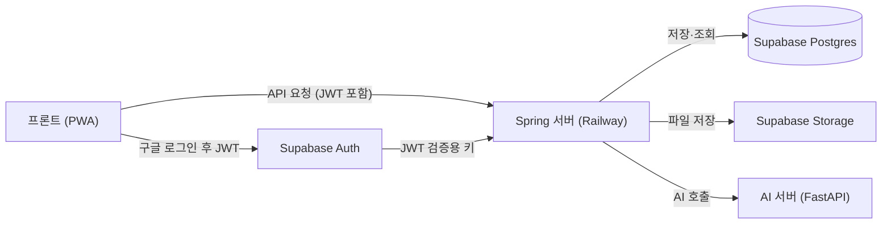

# 백엔드 개발 명세서 — 통학 AI 학습

최종 수정: 2026-11-04 · 관련 문서: [AI 서버 ↔ 백엔드 API 명세](./AI_서버_백엔드_API_명세.md)

## 1. 개요와 범위

이 문서는 통학 AI 학습 앱의 백엔드(Spring) 구현 기준이며, 출처는 기능명세서 PDF·CSV, 기능명세서 v2 xlsx(10/31), 결정사항 표다. 서비스는 사용자가 올린 강의자료를 AI가 단원으로 나누고, 통학 시간에 맞춘 요약본과 퀴즈를 제공한다.

**백엔드 책임**

- 구글 로그인 JWT 검증, 사용자·통학 설정·과목·자료·단원·문제·세션·답안·오답 저장
- 자료 파일 저장과 검증(형식·용량)
- AI 서버(FastAPI) 호출 중계와 실패 처리
- 학습 가능 시간·문제 수 계산, 진도·정답률·오답 집계, 질문 횟수 제한 강제

**백엔드 책임이 아닌 것**: 화면, 스와이프 같은 조작, 기기 내 임시 저장(LN-07의 로컬 저장), 프롬프트와 모델 선택(AI 담당).

### 범위

| 우선순위 | 포함 기능 |
| --- | --- |
| P0 (MVP 필수) | AU-02 통학 시간 설정, AU-04 구글 로그인, AU-05 로그인 유지, MT-01 과목 등록, MT-02 자료 업로드, MT-03 단원화·요약, CR-01\~04 단원 선택·양식·커리큘럼·복습 퀴즈, LN-01·02·03·05·07 학습·O/X·객관식·단답형·해설·이어하기, RP-01\~04 통학 후 요약·정답률·오답노트·진도 |
| P1 (시간 되면) | MT-04 족보·기출, CR-05 시험까지 남은 통학, LN-04 논술형 채점, LN-06 AI 질문, NT-01 통학 알림 |
| P2 (이번에는 안 함) | RP-05 유사 문제, RP-06 오답 분석, 비밀번호 재설정·탈퇴, AI 질문 확장(유료), 학습 스트릭·친구 비교, 음성 학습(TTS), 지하철 경로 API |

### 이번에 만들지 않는 것 (결정)

- **이메일 가입·로그인(AU-01, AU-03)**: 구글 로그인만 구현한다. 이메일은 앱 전체 동작 확인 후 추후 결정한다(결정사항 AU-04, AU-01). 기능 표에서는 P0로 적혀 있으므로 일정에서 제외해야 한다.
- **해설 화면의 유사 문제 버튼(LN-05)**: RP-05가 P2·보류이므로 임시로 제외한다. 확정 필요(13장).

## 2. 시스템 구성



프론트는 Supabase Auth에서 구글 로그인으로 JWT를 받고, 이후 모든 요청을 Spring 서버에 보낸다. Spring은 JWT를 검증하고 DB·Storage에 저장하며, AI 서버는 Spring만 호출한다. Spring 서버만 Railway에 배포하고, DB·Storage·Auth는 Supabase를 쓴다. AI 서버도 같은 Railway 프로젝트에 두고 내부망 주소로만 호출한다(8장).

## 3. 개발 환경·배포

백엔드는 Spring Boot 4.1.2 + Java 21 + Supabase Postgres이고, Railway에 배포한다. 아래 내용은 레포 `develop`(2026-11-04)의 `build.gradle`, `application.yaml`, `README.md`, `CONVENTION.md`, `db/migration` 기준이다.

### 스택

| 항목 | 내용 |
| --- | --- |
| 언어·빌드 | Java 21, Gradle |
| 프레임워크 | Spring Boot 4.1.2 (WebMVC, Data JPA, Validation, Actuator) |
| 보안 | Spring Security + OAuth2 Resource Server (Supabase JWT 검증 예정) |
| DB | PostgreSQL (Supabase, 팀 공용 1개) |
| 마이그레이션 | Flyway (`src/main/resources/db/migration`) |
| 문서 | springdoc-openapi 3.2.0 (Swagger UI) |
| 기타 | Lombok |
| AI 연동 | AI 서버(FastAPI)를 HTTP로 호출. 계약은 [AI 서버 ↔ 백엔드 API 명세](./AI_서버_백엔드_API_명세.md) 문서 |

### 로컬 실행

1. `.env.example`을 복사해 루트에 `.env`로 저장한다 (git 제외).
2. Supabase의 Connection pooling(Transaction mode, 6543 포트) 접속 정보를 `spring.datasource.*`에 채운다. `.env` 키는 **소문자 + 점 표기**다.
3. 마이그레이션용 5432(Session/Direct) 접속 정보를 `spring.flyway.url`, `.user`, `.password`에 채운다. 6543(Transaction pooling)은 Flyway의 advisory lock과 호환되지 않아 분리했다.
4. `./gradlew bootRun`으로 실행하고 Swagger로 확인한다. AI 서버를 붙일 때는 AI 레포를 로컬에서 `AI_MOCK=true`로 띄우고 `ai.server-url`, `ai.internal-key`를 맞춘다(합의 #10).
5. DB 비밀번호는 공개 채널이 아니라 팀원 간 별도 채널로 공유한다.

### Railway 배포

Railway Variables에는 **대문자 + 언더스코어** 표기를 쓴다. `PORT`는 Railway가 주입하고 `server.port: ${PORT:8080}`이 이를 반영한다. 빌드는 `./gradlew bootJar`다. AI 서버와 같은 Railway 프로젝트·환경에 두고 내부망으로만 호출한다.

| 변수 | 용도 | 상태 |
| --- | --- | --- |
| `SPRING_DATASOURCE_URL` / `_USERNAME` / `_PASSWORD` | Supabase DB 접속(6543 풀링) | 사용 중 |
| `SPRING_FLYWAY_URL` / `_USER` / `_PASSWORD` | 마이그레이션용 5432 접속 | 필요 |
| `AI_SERVER_URL` | AI 서버 주소. 예: `http://commute-study-ai.railway.internal:8000` (포트 포함) | 추가 예정, 이름은 합의 #10 |
| `AI_INTERNAL_KEY` | AI 서버의 같은 이름 변수와 **같은 값** | 추가 예정, 이름은 합의 #10 |
| JWT 검증용 설정 (issuer 또는 JWK set URL) | Supabase 로그인 토큰 검증 | 추가 예정, 값은 Supabase에서 확인 |
| Supabase Storage 접근 정보 | 자료 파일 저장·서명 URL 생성 | 추가 예정 |

Railway 파일 시스템은 재배포마다 초기화되므로 업로드 파일을 서버 디스크에 둔다고 가정하지 않는다(자료는 Storage에 저장).

### DB 스키마 운영 (확정)

Flyway로 관리하고 `spring.jpa.hibernate.ddl-auto`는 `validate`다. `V1__init_schema.sql`은 이미 적용됐으므로 **수정하지 않는다**(체크섬 불일치로 기동 실패). 변경은 `V2__...sql` 이후 파일로 추가하고, 엔티티는 스키마와 정확히 맞아야 기동한다. 사용자 테이블 이름은 예약어를 피해 `app_user`다. AI 연동에 필요한 V2 변경은 6장과 API 명세 11장에 있다. PostgreSQL 열거형(`material_status` 등)을 엔티티에 매핑하려면 네임드 enum 매핑이 필요하다.

### 브랜치·커밋 규칙 (CONVENTION.md)

- 기본 브랜치 `develop`, 직접 push 금지, PR로만 병합
- 작업 브랜치 `{Type}/#{이슈번호}` (예: `Feat/#9`), 이슈를 먼저 만든 뒤 시작
- 커밋 `[{Type}/#{이슈번호}] {Type}: {한글 작업 내용}`, 끝에 마침표 없음
- 이슈 제목 `[Feat] 작업 내용`

## 4. 인증·권한

로그인은 구글만 지원하고, 서버는 로그인을 직접 처리하지 않고 Supabase가 발급한 JWT만 검증한다. 이메일 가입·로그인은 이번 범위에서 제외한다(1장).

### 로그인 흐름 (구현 방침)

1. 프론트가 Supabase Auth로 구글 OAuth 로그인을 진행하고 JWT를 받는다.
2. 모든 API 요청에 `Authorization: Bearer <JWT>`를 붙인다.
3. Spring이 서명·만료를 검증하고 JWT의 `sub`(Supabase 사용자 UUID)를 사용자 식별자로 쓴다.
4. 로그인 직후 프론트가 `GET /users/me`를 호출한다. 서버는 사용자가 없으면 **자동 생성**(닉네임 = 구글 이름)하고, 통학 설정·과목 등록 여부를 함께 내려준다. 프론트는 이 값으로 S-04(통학 시간 설정) 또는 S-20(홈)으로 분기한다(AU-04).
5. 로그인 유지(AU-05)와 토큰 갱신은 Supabase 클라이언트가 맡는다. 서버는 만료된 토큰에 401을 주고, 로그아웃은 클라이언트에서 세션을 지우는 것으로 끝난다(서버 API 없음, 제안).

### 인증 상태

상태는 테이블에 저장하지 않고 `GET /users/me` 응답에서 데이터로 계산해 내려준다.

| 상태 | 의미 | 서버 판단 기준 |
| --- | --- | --- |
| `ANONYMOUS` | 미로그인, S-01로 유도 | JWT 없음·만료 (서버 응답 401) |
| `AUTHENTICATED` | 로그인 완료, 최초 설정(통학 시간·과목 등록) 미완료 | 통학 설정 또는 과목이 없음 |
| `ACTIVE` | 로그인 + 최초 설정 완료 | 통학 설정이 있고 과목이 1개 이상 |

제약: 통학 시간과 과목이 없으면 커리큘럼을 만들 수 없다(세션 생성 API가 검사). 최초 설정 완료는 되돌리지 않고, 설정 변경은 S-60에서한다.

### 접근 규칙

- 공개 경로는 Swagger와 `/actuator/health`뿐이고, 나머지는 인증이 필수다. 현재 `SecurityConfig`의 `anyRequest().permitAll()`은 이 작업에서 제거한다.
- 모든 리소스(과목·자료·세션·오답 등)는 요청자 소유인지 확인한다. 다른 사용자의 데이터는 404로 응답해 존재를 드러내지 않는다(제안).
- 운영에서 CORS는 프론트 도메인만 허용한다(도메인은 프론트와 확정).

### 보류·미정

- 이메일로 가입한 사람이 같은 메일의 구글로 로그인하는 경우: 이메일 로그인을 넣을 때 결정한다(결정사항 AU-04).
- 닉네임 수정: AU-04에 "나중에 수정 가능"이라고만 있고 화면·규칙(길이 2\~10자 적용 여부)이 없다. 이슈에서 확정한다(13장).

## 5. 설정값

문서마다 값이 다르거나 바뀔 수 있는 숫자는 코드에 박지 않고 설정값(`application.yaml` 또는 환경변수)으로 읽는다. 값이 바뀔 때 재배포만 하면 된다. 키 이름은 제안이다. 상태는 팀 결정(코멘트, 2026-11-04) 반영 기준이다.

### 학습·업로드·리포트

| 설정 | 키 (제안) | 기본값 | 상태 | 비고 |
| --- | --- | --- | --- | --- |
| 학습 가능 시간 | (설정 없음) | 입력한 편도 이동 시간 그대로 | 확정 | 비율을 고정하지 않는다. 안내 문구: "환승·도보 시간을 뺀 지하철에 있는 시간을 입력하세요"(프론트) |
| 커리큘럼 최소 학습 시간 | `study.curriculum-min-minutes` | 20분 | 확정 | 학습 가능 시간(=입력한 편도 시간) 기준. 20분 미만은 복습 퀴즈만 |
| 편도 이동 시간 범위 | `commute.min-minutes` / `max-minutes` | 5 / 180분 | 미정 | AU-02 규칙에는 있으나 결정이 없다 |
| 요약본 읽기 시간 | `study.summary-minutes` | 3분 | 미정 | 커리큘럼 모드에서만 차감 |
| 문항당 소요 시간 | `study.minutes-per-question.ox` / `.mc` / `.short` / `.essay` | 0.5 / 1 / 1.5 / 5분 | 확정(논술은 논술형 포함 결정에 따름) | **유형별로만** 정하고 난이도별 시간은 없다 |
| 업로드 파일당 용량 | `upload.max-file-mb` | 30MB | 확정 | 백엔드가 업로드 단계에서 거부 |
| 업로드 쪽수·장수 | (AI 서버가 검사) | PDF·PPT 100쪽, PNG 20장 | 확정 | 파일을 열어야 알 수 있어 AI 서버가 `PAGE_LIMIT_EXCEEDED`로 돌려준다 |
| 허용 형식 | `upload.allowed-types` | PDF, PPTX, PNG | 확정 | 구버전 `.ppt`는 AI 서버가 읽지 못해 업로드 단계에서 막는다. DOCX·HWP는 받지 않는다 |
| AI 질문 하루 한도 | `ai.question-daily-limit` | 10회 | 확정 | 꼬리질문·추가 질문 합산, 남은 횟수 표시, 호출 실패 시 차감 안 함 |
| 정답률 그래프 최소 응답 수 | `report.min-answers` | 5개 | 확정 | 하루 응답 5개 미만인 날은 추이에서 **제외**(점을 찍지 않음) |
| 남은 통학 횟수 배수 | `exam.commutes-per-day` | 2 | 미정 | P1 |
| 알림 시각 | `notify.minutes-before` | 5분 전 | 확정 | P1 |
| 일 단위 시간대 | `app.timezone` | Asia/Seoul | 제안 | AI 질문 횟수·일별 정답률의 날짜 경계 |

### AI 서버 연동 (API 명세 기준)

| 설정 | 키 (제안) | 기본값 | 상태 | 비고 |
| --- | --- | --- | --- | --- |
| AI 서버 주소·내부 키 | `ai.server-url`, `ai.internal-key` | 환경변수 `AI_SERVER_URL`, `AI_INTERNAL_KEY` | 합의 #10 | 키는 로그에 남기지 않는다 |
| 동시 호출 수 | `ai.max-concurrency` | 3 | 합의 #2 | AI-01·AI-02 긴 호출의 동시 실행 수 |
| 호출 타임아웃 | `ai.timeout.{health,ai01,ai02,ai02-extra,ai03,ai04,ai05,ai06}` | 5 / 300 / 300 / 90 / 5 / 20 / 15 / 15초 | 합의 #6, #15 | AI-03은 사용자 기준 3초로 줄이자는 제안 |
| 서명 URL 유효시간 | `ai.signed-url-ttl-minutes` | 10분 | 합의 #1 | 호출·재시도마다 새로 만든다 |
| 처리 중 고착 정리 | `material.processing-timeout-minutes` | 10분 | 제안 | 이 시간을 넘은 `PROCESSING`은 `FAILED`로 정리 |
| 단원·난이도별 문제 상한 | `question.max-per-category-difficulty` | 60개 | 확정(AI 서버 명세) | 이 수에 닿으면 AI-02를 호출하지 않고 이미 나온 문제를 다시 낸다 |
| 미리 생성 규모 | `question.pregen` | OX 10, MC 15, SHORT 5 (중 난이도) | 합의 #5 | 단원당 30문제 |

## 6. 데이터 모델

실제 스키마는 `V1__init_schema.sql`(2026-11-03 리포 병합)다. 아래 표는 V1 기준이고, AI 서버 연동에 필요해 V2에서 바꿔야 할 것을 오른쪽 열에 적었다(근거는 [AI 서버 ↔ 백엔드 API 명세](./AI_서버_백엔드_API_명세.md) 11장). 사용자 테이블 이름은 `app_user`이고 Supabase `auth.users`와 1:1이다. 테이블 이름은 소문자 스네이크케이스다.

### 테이블

| 테이블 | V1 컬럼 | V2에서 바꿀 것 |
| --- | --- | --- |
| `app_user` | id(uuid, `auth.users.id`를 참조), nickname, created\_at | 없음 |
| `commute_profile` | user\_id, from\_station, to\_station, one\_way\_min, departure\_time(P1), notify\_enabled(P1, 기본 false) | 없음 |
| `subject` | id, user\_id, name, exam\_date, created\_at | 없음 |
| `material` | id, subject\_id, file\_url, file\_type, kind, size, page\_count, status, error\_message, created\_at | `file_name` 추가. PNG 여러 장 저장 구조(합의 #3) |
| `category` | id, subject\_id, material\_id, name, page\_start, page\_end, summary, order | `question_status`(`GENERATING`/`DONE`/`FAILED`) 추가 |
| `question` | id, category\_id, type, difficulty, stem, choices(jsonb), answer, accepted\_answers(jsonb), rubric(text), explanation, source\_page | `concept_tags jsonb` 추가, `rubric`을 jsonb로 |
| `session` | id, user\_id, category\_ids(bigint\[\]), question\_types(jsonb), difficulty, study\_min, mode, status, started\_at, ended\_at | `feedback text` 추가 |
| `session_question` | session\_id, question\_id, order | 없음 |
| `attempt` | id, user\_id, question\_id, session\_id, answer, correct(null 허용), score(numeric), answered\_at | `self_judged boolean` 추가 |
| `wrong_note` | user\_id, question\_id, wrong\_count, status(`OPEN`/`RESOLVED`), last\_wrong\_at | 없음 |
| `ai_question_usage` | user\_id, date, count | 없음(P1) |
| `material_page` | (V1에 없음) | **신규**: material\_id, page, text |

관계: `app_user` 1 — N `subject` 1 — N `material` / `category` 1 — N `question`. `material` 1 — N `material_page`. `app_user` 1 — N `session` N — N `question`(`session_question`). `attempt`는 session·question을 가리키고, `wrong_note`는 (app\_user, question)당 1행이다.

### 상태 전이

아래 상태값은 기능명세서 3장의 값이다. PDF에서 일부 표가 잘려 있는 세션 상태는 정의와 금지 전이에서 정리했다.

**자료 처리 상태 (`material.status`)**

| 현재 | 트리거 | 다음 |
| --- | --- | --- |
| (없음) | 업로드 성공 (MT-02) | `UPLOADED` |
| `UPLOADED` | 처리 시작 | `PROCESSING` |
| `PROCESSING` | 단원화·요약 완료 (AI-01) | `READY` |
| `PROCESSING` | 텍스트 인식 실패 또는 AI 응답 2회 오류 | `FAILED` |
| `FAILED` | 사용자가 다시 시도 | `PROCESSING` |

금지: `READY` → `PROCESSING`(완료된 자료는 다시 처리하지 않고 새로 업로드), `UPLOADED` → `READY`(단원화 없이 학습 불가).

**학습 세션 상태 (`session.status`)**

| 현재 | 트리거 | 다음 |
| --- | --- | --- |
| (없음) | 커리큘럼 생성 완료 (CR-03) | `READY` |
| `READY` | 출발(학습 시작) | `IN_PROGRESS` |
| `IN_PROGRESS` | 마지막 문제까지 응답 | `COMPLETED` |
| `IN_PROGRESS` | 중간 종료(그만하기), 도착, 새로 시작 | `ENDED` |

금지: `COMPLETED`·`ENDED`는 다시 열지 않는다(이어 할 때는 새 세션 생성). 사용자당 `IN_PROGRESS`는 동시에 1개. 출발하지 않은 `READY`는 `COMPLETED`가 될 수 없다.

**오답 상태 (`wrong_note.status`)**

| 현재 | 트리거 | 다음 |
| --- | --- | --- |
| (없음) | 문제 오답 | `OPEN` |
| `OPEN` | 다시 풀어 오답 | `OPEN` (wrong\_count + 1) |
| `OPEN` | 다시 풀어 정답 | `RESOLVED` |
| `RESOLVED` | 같은 문제를 다른 세션에서 다시 틀림 | `OPEN` |

금지: 오답노트에서 삭제하지 않는다. 틀린 기록은 정답률 그래프의 근거다.

## 7. API 명세

앱이 호출하는 백엔드 API다. xlsx API 명세를 기준으로 하되 JWT로 사용자를 알 수 있어 `/users/{id}/...`를 `/users/me/...`로 바꾸고 빠진 엔드포인트를 추가했다(**제안**). 열거형 값은 DB·AI 서버와 같은 대문자를 쓴다: `mode`는 `CURRICULUM`/`REVIEW`, `kind`는 `LECTURE`/`PAST_EXAM`, 문제 `type`은 `OX`/`MC`/`SHORT`/`ESSAY`이고 `difficulty`는 정수 1(하)·2(중)·3(상)다. AI 서버 응답은 그대로 노출하지 않고 필요한 필드만 골라 내려준다(AI 호출 상세는 [AI 서버 ↔ 백엔드 API 명세](./AI_서버_백엔드_API_명세.md)). 사용자 API의 JSON 필드이름 표기(snake\_case 또는 camelCase)는 프론트와 정해야 한다(13장). 모든 요청은 인증이 필요하고 공통 응답·에러 형식은 10장에 있다. 목록 API는 데이터가 적어 페이지네이션을 두지 않는다(제안).

### 인증·통학 설정

| 메서드 경로 | 기능 | 우선순위 | 요청 → 응답 |
| --- | --- | --- | --- |
| `GET /users/me` | AU-04, AU-05 · 내 정보. 없으면 자동 생성 | P0 | → `{user_id, nickname, status, commute?, has_subject}` (status = `AUTHENTICATED` 또는 `ACTIVE`) |
| `PUT /users/me/commute` | AU-02 · 통학 설정 저장·수정 | P0 | `{from_station, to_station, one_way_min}` → `{study_min, mode}` (`study_min` = `one_way_min`, mode = `CURRICULUM` 또는 `REVIEW`) |
| `GET /users/me/commute` | AU-02 · 설정 화면(S-60) 조회 (제안) | P0 | → 저장된 설정 + `{study_min, mode}` |
| `PUT /users/me/notification` | NT-01 · 알림 켜기·끄기와 등교 시각 (제안) | P1 | `{enabled, departure_time}` → `{enabled, departure_time}` |

### 과목·자료

| 메서드 경로 | 기능 | 우선순위 | 요청 → 응답 |
| --- | --- | --- | --- |
| `POST /subjects` | MT-01 · 과목 등록 | P0 | `{name(1~20자), exam_date?}` → `{subject_id}` |
| `GET /subjects` | 내 과목 목록 (제안) | P0 | → `{subjects:[{id, name, exam_date?}]}` |
| `GET /subjects/{id}` | CR-05 · 과목 정보와 남은 통학 | P1 | → `{name, exam_date, remaining_commutes?, untouched_categories}` |
| `POST /subjects/{id}/materials` | MT-02, MT-04 · 자료 업로드. 형식(`.pdf`, `.pptx`, `.png`)과 30MB를 검증하고 Storage에 저장한 뒤 비동기로 AI-01을 부른다 | P0 (`kind=PAST_EXAM`은 P1) | multipart `file`(PNG 여러 장은 합의 #3), `kind`(`LECTURE`/`PAST_EXAM`) → `{material_id, status}` |
| `GET /materials/{id}/status` | MT-03 · 처리 상태 폴링. AI 서버는 진행률을 주지 않아 `progress`는 없다 | P0 | → `{status, category_count, error?}` (`error` = AI 서버 `message`) |
| `POST /materials/{id}/retry` | MT-03 · `FAILED` 자료 재처리(M5). 원래 명세에 없던 엔드포인트 (제안) | P0 | → `{status}` |
| `GET /subjects/{id}/categories` | CR-01, RP-04 · 단원 목록·진도 | P0 | → `{categories:[{id, name, pages, progress, accuracy, last_studied_at, state, question_status}], recommended_id}` (`state` = 안 함/진행 중/완료, `question_status` = `GENERATING`/`DONE`/`FAILED`) |
| `PATCH /categories/{id}` | MT-03 · 단원명 수정 (제안) | P1 | `{name}` → `{id, name}` |

단원 목록 화면(S-11)의 "완료" 버튼은 화면 이동만 하고 서버 호출이 없다고 본다(제안). 단원은 `READY`가 되는 시점에 이미 저장되어 있다.

### 커리큘럼·학습

| 메서드 경로 | 기능 | 우선순위 | 요청 → 응답 |
| --- | --- | --- | --- |
| `POST /sessions` | CR-02, CR-03, CR-04 · 오늘의 커리큘럼 생성 | P0 | `{source, category_ids?, question_types, difficulty, today_one_way_min?}` → `{session_id, mode, study_min, question_count, summary?, shortage?, questions:[{id, type, stem, choices?, source_page}]}` |
| `GET /sessions/current` | LN-07 · 이어하기용 진행 중 세션 (제안) | P0 | → `{session_id, category_name, answered, total}` 또는 204 |
| `POST /sessions/{id}/start` | LN-01 · 출발, READY→IN\_PROGRESS (제안) | P0 | → `{status, started_at}` |
| `POST /sessions/{id}/end` | LN-01 · 중간 종료, ENDED (제안) | P0 | `{reason}` → `{status}` |
| `POST /attempts` | LN-02, LN-07 · 응답 일괄 전송 | P0 | `{session_id, attempts:[{question_id, answer, correct?, self_judged?, answered_at}]}` → `{saved, progress, session_status}` |
| `POST /answers/judge` | LN-03 · 단답형 판정(AI-03) | P0 | `{question_id, answer}` → `{correct, reason}`, 시간 초과·실패면 `{correct: null, timeout: true}` |
| `GET /questions/{id}/explanation` | LN-05 · 해설·개념·근거 쪽수 (제안) | P0 | → `{explanation, source_page}` |
| `POST /answers/grade` | LN-04 · 논술형 채점(AI-04). 응답은 AI 서버 형식에 맞춘다(합의 #8) | P1 | `{question_id, answer}` → `{correct, score, points:[{point, met, reason}], feedback}`, 실패하면 `{status: LATER}` |
| `POST /questions/{id}/ask` | LN-06 · AI 질문(AI-05). 응답은 SSE(`delta`/`done`/`error`), 남은 횟수를 함께 준다(합의 #9) | P1 | `{message}` (꼬리질문 버튼은 고정 문구) → `text/event-stream` |

`POST /sessions`의 `source`는 `categories`(단원 선택) 또는 `wrong_notes`(오답노트 다시 풀기·복습)다. 학습 가능 시간이 20분 미만이면 요청에 상관없이 `mode`가 review로 정해진다(9장).

### 리포트·오답노트

| 메서드 경로 | 기능 | 우선순위 | 요청 → 응답 |
| --- | --- | --- | --- |
| `GET /subjects/{id}/report?scope=session&session_id=` | RP-01 · 통학 후 요약 | P0 | → `{today:{minutes, solved, accuracy, wrong}, feedback?}` |
| `GET /subjects/{id}/report?scope=all` | RP-02 · 정답률 그래프 | P0 | → `{accuracy_trend:[{date, accuracy, answers}], by_category:[{id, accuracy}], average}` |
| `GET /subjects/{id}/wrong-notes?category_id=` | RP-03 · 오답 목록 | P0 | → `{items:[{question_id, category_id, stem, wrong_count, status, last_wrong_at}]}` |

오답노트 "다시 풀기"는 별도 API 없이 `POST /sessions`(`source: wrong_notes`)로 한다. 하루 응답이 5개 미만인 날은 서버가 `accuracy_trend`에서 빼고 점을 찍지 않는다. 클라이언트는 점이 2개 이상이면 선으로 잇고, 1개면 안내 문구를 보여준다.

### 결정이 필요한 API 설계 사항

- **정답을 세션 응답에 포함할지**: AI-02는 모든 유형의 `answer`와 `explanation`을 이미 준다. O/X·객관식은 0.3초 채점과 오프라인 저장(LN-07) 때문에 정답이 앱에 있어야 하므로 `answer`와 `explanation`을 세션 응답에 포함하고, 단답·논술은 내려주지 않는 것을 제안한다. `POST /attempts`의 `correct`는 서버가 O/X·객관식은 다시 계산해 보정한다. (아직 미정)
- **일괄 전송 중복**: `(session_id, question_id)`당 응답은 1개만 저장하고 이미 있으면 무시한다(제안).
- **세션 전체 조회**: 이어하기에 `GET /sessions/{id}`(전체 문제와 푸는 문제)가 필요한지.
- **푸시 알림**: PWA 웹 푸시 구독 저장과 발송 방식은 P1이라 정하지 않는다(13장).

## 8. AI 서버 연동

AI 서버(FastAPI, 별도 레포 `commute-study-ai`)는 DB 없이 백엔드만 호출하는 내부 API다. 요청·응답 형식, 에러 코드, 타임아웃, 합의 필요 항목은 [AI 서버 ↔ 백엔드 API 명세](./AI_서버_백엔드_API_명세.md)에 있고, 이 장은 백엔드가 지킬 것만 요약한다. 기준은 AI 레포 `develop` `db9163d`(2026-11-04)다.

| ID | 호출 | AI 서버 상태 | 서버 상한 / 백엔드 타임아웃(초) | 백엔드 처리 |
| --- | --- | --- | --- | --- |
| AI-01 | 단원화·요약 | 구현됨 | 270 / 300 | 서명 URL로 파일 전달 → `category`·`material_page` 저장 → `READY`. 실패하면 `FAILED` |
| AI-02 | 문제·해설 생성 | 구현됨 | 80 / 300(미리 생성), 90(부족분) | 단원 `READY` 직후 미리 생성, 부족분은 커리큘럼 생성 때 |
| AI-03 | 단답형 판정 | 구현됨 | 4 / 5 | 정규화 비교 후 불일치일 때만 호출. 실패하면 `timeout: true` |
| AI-04 | 논술형 채점 (P1) | mock | 18 / 20 | 실패하면 "나중에 확인", 세션 종료 때 1회 재호출 |
| AI-05 | AI 질문 (SSE, P1) | mock | 13 / 15 | SSE 중계. `done`을 받을 때만 횟수 차감 |
| AI-06 | 통학 후 피드백 | 구현됨 | 13 / 15 | 푸는 문제가 있을 때만 세션당 1회. 실패하면 숫자 카드만 |

### 백엔드 호출 규칙

- AI 호출은 `AiClient` 인터페이스로 감싼다. **백엔드가 자체 mock 구현을 만들지 않는다.** AI 서버가 `AI_MOCK=true`(기본)로 고정 응답을 주므로 개발 중에는 AI 서버를 mock 모드로 띄워 쓴다. 실패 흐름은 `X-Mock-Error` 헤더로 시험하고, 단위 테스트는 가짜 HTTP 서버(`MockRestServiceServer` 등)로 한다.
- 요청에는 AI 서버가 정의한 필드만 담는다. 모르는 필드는 400 `INVALID_REQUEST`로 거부된다. 응답에 모르는 필드가 있으면 무시한다.
- 에러는 `{"error":{"code","message"}}` 한 가지 형태다. `message`는 `material.error_message`에 저장해 사용자에게 보여준다. 백엔드 타임아웃은 `AI_TIMEOUT`, 그 외 실패는 `AI_UNAVAILABLE`로 바꾼다(10장).
- AI 호출은 DB 트랜잭션 밖에서 하고 `spring.jpa.open-in-view: false`를 설정한다. 긴 호출(AI-01, AI-02)은 `@Async` 스레드에서 동시 3개까지 실행한다(합의 #2).
- 자료 파일은 Supabase Storage에 둔 뒤 **서명 URL**(유효시간 10분 제안)로 넘긴다. 호출마다 새로 만들고, `FILE_FETCH_FAILED`면 새 URL로 1회만 다시 호출한다(합의 #1).
- AI 서버는 상태가 없으므로 자료 쪽 텍스트(`material_page`)와 이전 대화는 매 요청에 담아 보낸다. 자료 원문과 내부 키는 로그에 남기지 않는다.

### AI 담당과 합의 필요 (우선 높음)

합의 항목 15개는 API 명세 12장에 있다. 연동 구현 전에 정해야 하는 것:

- **#1** 서명 URL 유효시간과 재서명
- **#3** PNG 여러 장을 한 자료로 받는 구조(V1 `material.file_url`은 1개)
- **#5** AI-02 사전 생성 규모와 부족분 흐름
- **#6** AI-03 시간 기준(사용자 3초 vs AI 4초·백엔드 5초)과 정규화 일치
- **#7** AI-06 요청에 지난 정답률 필드 추가
- **#10** 로컬 개발 접속과 환경변수 이름

## 9. 핵심 로직

기능명세서가 정한 계산과 처리 규칙을 백엔드 구현 기준으로 정리했다. 팀 결정(2026-11-04)과 AI 서버 계약(v0.2)을 반영했고, 명세에 없어 보완한 규칙은 \*\*(제안)\*\*이다.

### 9.1 학습 가능 시간과 모드 (AU-02)

```latex
\text{study\_min} = \text{one\_way\_min}
```

- 학습 가능 시간은 사용자가 입력한 편도 시간(환승·도보를 뺀 지하철 탑승 시간) **그대로**다. 비율을 곱하지 않는다(확정).
- `study_min` ≥ 20이면 `CURRICULUM`, 20 미만이면 `REVIEW`(복습 퀴즈만)다. 예: 50분은 `CURRICULUM`, 19분은 `REVIEW`, 20분은 `CURRICULUM`.
- 오늘만 시간을 바꾸는 경우(CR-02)는 `POST /sessions`의 `today_one_way_min`으로 받고 저장된 통학 설정은 바꾸지 않는다.
- 편도 이동 시간 범위(5\~180분)는 아직 미정이라 설정값으로 두고, 벗어나면 400으로 거부한다.

### 9.2 문제 수 계산 (CR-03)

```latex
\text{question\_count} = \left\lfloor \frac{\text{study\_min} - \text{summary\_min}}{\text{per\_question\_min}} \right\rfloor
```

- `summary_min`은 `CURRICULUM`에서만 3분을 빼고 `REVIEW`는 0이다.
- `per_question_min`은 **문제 유형별** 값(O/X 0.5, 객관식 1, 단답 1.5, 논술 5분)이고 **난이도는 시간에 영향을 주지 않는다**(확정). 유형을 여러 개 고르면 평균을 쓴다.
- 예: 50분·객관식 → (50 − 3) ÷ 1 = 47문제. O/X만이면 94문제, 객관식+단답형(평균 1.25)이면 37문제(소수점 버림). `REVIEW` 19분·객관식이면 19문제다.

### 9.3 문제 선택과 분량 부족

- 선택한 단원의 `question` 중 유형과 난이도(정수 1\~3)가 맞는 것을 고른다. 푸지 않은 문제를 먼저 쓴다(제안).
- 모자라면 AI-02로 **부족분만** 요청한다(백엔드 타임아웃 90초). `count` 합 40 이하로 나눠 부르고, `excludeStems`에는 이미 있는 문제 지문(최근 60개)을 담는다.
- 단원·난이도별 문제가 **60개**가 되면 더 요청하지 않고 이미 나온 문제를 다시 낸다(백엔드가 확인).
- 문제 생성 상태가 `GENERATING`인 단원에는 부족분을 요청하지 않는다(같은 문제를 중복 생성하게 된다). 이미 있는 문제로 세션을 만들거나 잠시 후 다시 시도하게 한다(제안).
- AI-02가 `shortfall`을 주거나 실패해도 있는 문제로만 세션을 만든다. 문제가 0개이면 세션을 만들지 않고 실패를 안내해 사용자가 다시 시도하게 한다.
- 그래도 목표보다 적으면 응답에 `shortage:{target, available}`를 담아 내린다. 클라이언트가 "다음 단원 추가하기"/"이 단원만 풀기"를 묻고, 추가를 고르면 단원을 늘려 세션을 다시 만든다. 출발하지 않은 이전 `READY` 세션은 삭제한다(제안).
- `REVIEW` 모드는 요약본 없이 오답노트(`OPEN`) → 이미 푸는 단원 문제 순으로 채운다. 복습할 문제가 없으면 `questions`를 비우고 짧은 요약본 1개와 `no_review_items: true`를 내려준다.
- 모든 문제는 업로드한 자료 범위 안에서만 만들고 `source_page`가 있어야 한다. AI-02가 검증하고, 백엔드는 `source_page`가 단원 쪽 범위 안인지 방어적으로 확인한다.

### 9.4 자료 업로드와 단원화 비동기 처리 (MT-02, MT-03)

1. **검증**: 확장자(`.pdf`, `.pptx`, `.png`)와 Content-Type, 파일당 30MB를 확인해 실패하면 종류별 다른 문구로 400을 준다. 쪽수(PDF·PPT 100, PNG 20)는 AI 서버가 판단한다.
2. **저장**: 파일을 Supabase Storage에 사용자별 경로로 저장하고 `material`을 `UPLOADED`로 만든다. 업로드 응답은 여기까지만 하고 즉시 돌려준다.
3. **비동기 작업**: 별도 스레드에서 `PROCESSING`으로 바꾸고 서명 URL을 만들어 AI-01을 호출한다(`fileUrls`: PDF·PPT는 1개, PNG는 쪽 순서대로 여러 개). 사용자가 화면을 나가거나 앱을 닫아도 서버에서 계속 진행된다.
4. **결과 저장**: `pageCount`, `pages`(`material_page`), `categories`(`category`, `material_id` 포함)를 한 트랜잭션으로 저장하고 `READY`로 바꾼다. `pageStart ≤ pageEnd ≤ pageCount`를 방어적으로 확인한다.
5. **실패**: `UNSUPPORTED_FILE`, `PAGE_LIMIT_EXCEEDED`, `TEXT_EXTRACTION_FAILED`, `LLM_FAILED`, `LLM_TIMEOUT`은 `FAILED`이고 AI 서버 `message`를 `error_message`에 저장한다. `FILE_FETCH_FAILED`는 서명 URL을 새로 만들어 1회만 다시 호출하고 또 실패하면 `FAILED`다.
6. **재시도**: 사용자가 다시 시도하면 `PROCESSING`으로 되돌리고 같은 파일로 1회 호출한다. `READY` 자료는 다시 처리할 수 없다(409).
7. **재시작 복구**: 서버 재시작으로 호출이 끊긴 자료는 `PROCESSING`에 남는다. 10분이 넘은 `PROCESSING`을 `FAILED`로 정리한다(제안).
8. **문제 사전 생성**: `READY` 직후 단원별 AI-02를 백그라운드로 호출해 `question`을 저장한다(미리 생성 30문제 제안, 합의 #5). 단원의 `question_status`는 `GENERATING` → `DONE`/`FAILED`다.

### 9.5 응답 저장·오답 등록·세션 종료 (LN-02, LN-07, RP-03)

- `POST /attempts`는 일괄 전송이고 한 트랜잭션으로 저장한다. `(session_id, question_id)`가 이미 있으면 건너뛴다.
- O/X·객관식은 서버가 정답과 비교해 `correct`를 보정한다. 단답형은 판정 API 결과 또는 사용자가 고른 자가 판정(`self_judged: true`)을 받는다. 논술형 채점 대기는 `correct`가 null이다.
- 저장하면서 오답이면 `wrong_note`를 만들거나 `wrong_count`를 1 올리고 `OPEN`으로 둔다. 오답노트 다시 풀기에서 정답이면 `RESOLVED`로 바꾼다(목록은 유지).
- 세션의 모든 문제에 응답이 있으면 `COMPLETED`로 바꾸고, 중간 종료는 `/end`로 `ENDED`로 바꾼다. 한 사용자에게 `IN_PROGRESS`가 이미 있을 때 새 세션을 시작하면 기존 세션을 `ENDED`로 처리한다("새로 시작").

### 9.6 단답형 판정 (LN-03)

1. 백엔드가 답(최대 30자)을 정규화해 `accepted_answers`와 비교한다. 정규화는 AI 서버와 같은 규칙(유니코드 NFKC 후 소문자, 공백·문장부호 제거)을 쓴다. 일치하면 AI 호출 없이 정답이다.
2. 다르면 AI-03을 호출한다(`stem`, `acceptedAnswers`, `explanation`, `userAnswer`). 시간 안에 오면 `{correct, reason}`를 돌려준다.
3. 시간 초과·실패면 `{correct: null, timeout: true}`로 응답하고, 사용자가 대표 정답을 보고 맞음·틀림을 고른다. 자가 판정 결과도 정답률에 포함하고 `attempt.self_judged`에 저장한다.
4. 시간 기준(사용자 3초 vs AI 4초·백엔드 5초)은 합의 #6다.

### 9.7 진도·정답률 집계 (CR-01, RP-02, RP-04)

```latex
\text{progress} = \frac{\text{푸는 문제 수}}{\text{단원 문제 수}}
```

- 상태: 0이면 안 함, 0보다 크고 1 미만이면 진행 중, 1이면 완료. 푸는 문제 수는 서로 다른 문제를 셌다. 단원 문제 수는 그 단원에 생성된 문제 수다. 생성이 늘면 분모가 커져 진도가 줄 수 있어 확정이 필요하다(13장).
- 단원 정답률 = 단원 전체 응답 중 정답 비율(채점 대기 제외, 자가 판정 포함, 제안).
- 하루 정답률 = 그날 정답 ÷ 응답이고 날짜는 `Asia/Seoul` 기준이다. **하루 응답이 5개 미만인 날은 추이에서 제외**해 점을 찍지 않는다(확정). 점이 2개 이상이면 선으로 잇고 1개면 안내 문구를 보여주는 것은 클라이언트가 응답의 점 개수로 결정한다.
- 이어서 할 단원 추천: 진행 중인 단원 중 마지막 학습이 가장 최근인 것, 없으면 안 한 단원을 순서대로(CR-01).

### 9.8 통학 후 요약 (RP-01)

- 숫자 4개(학습 시간, 푸는 문제, 정답률, 담긴 오답 수)는 즉시 계산해 내려준다. 학습 시간은 출발부터 마지막 응답 시각까지다(제안).
- 피드백은 AI-06으로 만든다. 호출 조건: 세션이 `COMPLETED` 또는 `ENDED`이고, 푸는 문제(`answered`)가 1개 이상이며 "새로 시작"으로 끝난 세션이 아니어야 한다. 채점 대기 답안은 `answered`·`correct`에서 빼고 보낸다.
- 요청은 `sessionId`, `mode`, `total`, `answered`, `correct`, `correctConcepts`, `wrongItems`(지문과 개념 태그)다. 시간 안에 오지 않으면 `feedback: null`로 내려 숫자 카드만 보여준다. 생성된 피드백은 `session.feedback`에 저장해 세션당 1회만 호출한다.
- "지난번보다 정답률이 %p 올랐어요" 같은 비교는 AI-06 요청에 이전 정답률 필드가 있어야 가능하다(합의 #7).

### 9.9 AI 질문 횟수 (LN-06, P1)

- 하루 한도는 **10회**(꼬리질문과 추가 질문 합산, 확정)이고 `ai_question_usage`의 조건부 증가로 서버에서 강제한다. 한도가 찬 날은 429 `AI_QUESTION_LIMIT`다.
- 차감은 AI-05에서 `done` 이벤트를 받았을 때만 한다. 실패하면 차감하지 않는다.
- 사용자당 진행 중인 질문은 1개로 제한한다. 진행 중에 새 요청이 오면 409로 거부한다(제안).

### 9.10 시험까지 남은 통학 (CR-05, P1)

남은 통학 = 오늘부터 시험 전날까지 등교일 수 × 2. 등교 요일이 저장되지 않아 지금은 계산할 수 없다(xlsx는 이 기능을 쓸 때만 등교 요일을 추가하라고 함). 이슈에서 등교 요일 입력 여부를 먼저 정한다.

## 10. 공통 규칙

이 장의 형식은 모두 \*\*(제안)\*\*이며 프론트와 합의 후 확정한다. 이 규칙은 포맷이 다른 API가 생기지 않도록 공통 뼈대 이슈에서 먼저 구현한다.

### 응답과 에러 포맷

- 성공 응답은 래퍼 없이 리소스 JSON을 그대로 내려준다(7장의 응답 형태 그대로). 생성은 201, 본문 없음은 204.
- 에러는 `{code, message, details?}` 한 가지 형태로 내려준다. 사용자에게 보여줄 문구는 프론트가 `code`로 정하고, 최대 용량 같은 숫자는 `details`에 담는다. `message`는 개발자용이다.

| HTTP | code | 쓰는 경우 |
| --- | --- | --- |
| 400 | `VALIDATION_ERROR` | 입력 형식·범위 오류 (과목명 1\~20자, 편도 5\~180분, 답 길이 등) |
| 400 | `UNSUPPORTED_FILE_TYPE` | 지원하지 않는 확장자 |
| 400 | `FILE_TOO_LARGE` | 용량·쪽수·장수 초과 (`details`에 한도) |
| 401 | `UNAUTHORIZED` | JWT 없음·만료·검증 실패 |
| 404 | `NOT_FOUND` | 없는 리소스, 다른 사용자의 리소스 |
| 409 | `STATE_CONFLICT` | 금지된 상태 전이 (완료된 자료 재처리, 끝난 세션 재사용 등) |
| 422 | `MATERIAL_NOT_READY` | 단원화가 끝나지 않은 자료로 학습·커리큘럼 요청 |
| 422 | `SETUP_REQUIRED` | 통학 설정 또는 과목 없이 커리큘럼 생성 요청 |
| 429 | `AI_QUESTION_LIMIT` | AI 질문 하루 한도 초과 |
| 502 / 504 | `AI_UNAVAILABLE` / `AI_TIMEOUT` | AI 서버 오류·지연. 8장의 실패 시 동작을 함께 내려줌 |
| 500 | `INTERNAL_ERROR` | 그 외 (스택 트레이스는 응답에 넣지 않음) |

### 검증과 입력

- 입력 검증은 Bean Validation으로 한다. 숫자 제한은 5장 설정값을 쓴다.
- 기본 `multipart` 크기 제한은 작아서 업로드 한도보다 크게 올려야 한다(`spring.servlet.multipart.max-file-size`, `max-request-size`). 없으면 업로드 한도와 상관없이 플레임워크가 먼저 거부한다.

### 시간·ID

- DB에는 UTC로 저장하고, API는 ISO-8601(오프셋 포함)로 주고받는다. 하루 단위 집계(정답률, AI 질문 횟수)의 경계는 `Asia/Seoul` 자정이다.
- `user.id`는 Supabase UUID이고, 나머지 테이블 ID는 자동 증가 정수를 쓴다(제안). 다른 사용자의 ID를 넣어도 소유자 확인으로 막는다(4장).

### 로깅

- 에러와 AI 호출 실패를 남긴다(8장). JWT, 비밀번호, 자료 원문, 사용자 답안은 로그에 남기지 않는다.
- 현재 `application.yaml`에 `show-sql: true`가 켜져 있다. 개발에만 켜고 운영에서는 끄는 프로파일 분리가 필요하다.

### 보안

- 비밀 값(DB 비밀번호, AI 서버 키, Supabase 키)은 환경변수로만 두고 저장소에 올리지 않는다. 플래그 값이 필요하면 `.env.example`에 키만 적는다.
- 업로드는 확장자와 Content-Type을 함께 확인하고, Storage 경로에 사용자 ID를 넣어 분리한다. 파일은 공개 URL이 아니라 서명 URL로만 제공한다(제안).
- CORS는 프론트 도메인만 허용한다. Swagger는 개발과 데모에서 쓰고, 운영 노출 여부는 결정한다(13장).

## 11. 개발 순서와 이슈 매핑

이슈 상태는 2026-11-04 레포 기준이다. 실제 이슈 #1은 PRD, #2\~#4는 머지된 기반 작업, #5·#6은 열려 있고 담당자가 없다. 나머지 이슈는 아직 올리지 않았고 "이슈 본문 초안" 문서의 초안 번호를 쓴다. **AI 서버는 mock으로 이미 완성됐으므로 업로드→단원화→문제 생성→세션을 바로 끝에서 끝까지 붙일 수 있다.** 두 백엔드 개발자는 한 사람(A)이 인증·자료 쪽, 다른 사람(B)이 학습·리포트 쪽을 맡는 것을 제안한다.

| 단계 | 이슈 | 실제 번호·상태 | 담당 제안 | 선행 |
| --- | --- | --- | --- | --- |
| 1. 기반 | Railway 배포및 헬스체크 | #2 완료 | - | - |
| 1. 기반 | ERD·Flyway 스키마(엔티티는 기능 이슈에서) | #3 완료 | - | - |
| 1. 기반 | 개발용 시드 데이터 | #4 완료 | - | - |
| 1. 기반 | 공통 응답·예외 처리 및 설정값 구조 | #5 열림 | B | - |
| 1. 기반 | AI 서버 연동 클라이언트 | #6 열림. 본문을 "자체 mock 없이 AI 서버 mock 사용"으로 고쳐야 함 | B | #5 |
| 1. 기반 | V2 마이그레이션(AI 연동 스키마 보완) | 이슈 없음, 새로 필요 | A 또는 B | #3, 합의 #3 |
| 2. 인증·통학 설정 | Supabase JWT 검증, 사용자 프로필, 통학 시간 설정 | 이슈 없음(초안 #5\~#7) | A | #5 |
| 3. 과목·자료·단원화 | 과목 등록, 자료 업로드, 단원화 비동기 처리, (P1) 단원명 수정·족보 | 이슈 없음(초안 #8\~#12) | A | V2, #6, 합의 #1·#3 |
| 4. 단원·커리큘럼 | 단원 목록·진도, 문제 생성 캐시, 세션 생성, 복습 모드, (P1) 시험까지 남은 통학 | 이슈 없음(초안 #13\~#17) | B | V2, #6, 시드(#4) |
| 5. 학습 | 답안 저장·채점, 단답 판정, 세션 상태·이어하기, 해설, (P1) 논술형·AI 질문 | 이슈 없음(초안 #18\~#23) | B | 세션 생성 |
| 6. 리포트 | 오답노트, 통학 후 요약, 정답률 그래프, (P1) 통학 알림 | 이슈 없음(초안 #24\~#27) | B | 답안 저장 |
| 7. 통합 | 전체 API 통합 테스트와 실제 AI 연동 검증 | 이슈 없음(초안 #29) | A, B | P0 이슈, AI 서버 실제 모드 |

### 두 사람이 맞물리는 지점

- **V2 마이그레이션**이 먼저다. `material_page`, 단원 문제 상태, `concept_tags` 없이는 단원화 저장과 문제 생성을 구현할 수 없다. PNG 여러 장 구조(합의 #3)는 확정해야 한다.
- **통학 시간 계산**(학습 가능 시간·모드)은 통학 설정과 세션 생성이 같은 로직을 쓴다. 공용 서비스로 두고 두 이슈가 같이 쓴다.
- **단원화(AI-01) → 문제 생성(AI-02)**: B는 시드로 먼저 개발하고, AI 서버 mock이 있으니 A의 업로드·단원화가 끝나면 실제 흐름으로 바로 확인한다.
- **AI 실제 모드 전환**: AI-01·02·03·06은 이미 실제 구현이 있어 `AI_MOCK=false`로 바꾸면 된다. AI-04·05는 아직 mock만 있다.

### P0 최소 데모 경로

구글 로그인 → 통학 시간 설정 → 과목 등록 → 자료 업로드·단원화 → 단원 선택 → 커리큘럼 생성 → 문제 풀이 → 통학 후 요약·오답노트. 팀의 일정 신호는 "2주 안에 자료 업로드, 문제 생성, 학습 화면, 정답률 그래프"다. 위 표의 1\~6단계가 이 경로를 이룬다.

## 12. 완료 체크리스트

기능명세서의 완료 기준과 위 장들의 규칙을 검증 가능한 항목으로 풀었다. 이슈의 완료 조건은 여기서 해당 항목을 가져간다. 시간 수치는 서버가 담당하는 구간 기준이다.

### 기능 (P0)

- [ ] 유효한 JWT로 `GET /users/me`를 호출하면 사용자가 자동 생성되고, 토큰이 없거나 만료되면 401이다
- [ ] 편도 50분 저장 시 `study_min` 50·`CURRICULUM`, 19분이면 `REVIEW`, 20분이면 `CURRICULUM`이고 범위 밖이면 400이다
- [ ] 과목명 1\~20자, 시험일은 없어도 저장된다
- [ ] 지원하지 않는 형식(구버전 `.ppt` 포함)과 30MB 초과가 각각 다른 에러 코드로 거부되고, 쪽수 초과는 AI 서버 `PAGE_LIMIT_EXCEEDED`로 자료가 `FAILED`가 된다
- [ ] 자료가 `UPLOADED` → `PROCESSING` → `READY`(실패 시 `FAILED`)로 바뀔고 상태 API로 확인되며, `FAILED`는 재시도할 수 있다
- [ ] 단원화 결과가 `category`와 `material_page`에 저장되고 모든 단원에 쪽 범위가 있다. 60쪽 PDF 기준 3분 안에 끝난다(실제 AI)
- [ ] 단원이 생기면 문제 사전 생성이 백그라운드로 시작되고 `question_status`가 `GENERATING` → `DONE`으로 바뀐다
- [ ] 단원 목록에 진도·정답률이 나오고 이어서 할 단원이 추천된다
- [ ] 편도 50분·객관식이면 문제 47개(= (50 − 3) ÷ 1), O/X면 94개다. 사전 생성된 문제로 세션 생성이 3초 안에 끝난다
- [ ] 학습 가능 20분 미만이면 요약본 없이 오답노트(`OPEN`) → 푸는 단원 문제 순으로 채워진다
- [ ] 응답 일괄 전송을 같은 내용으로 두 번 보내도 응답이 중복 저장되지 않는다
- [ ] 틀린 문제가 즉시 오답노트에 `OPEN`으로 쌓이고, 다시 풀어 맞히면 `RESOLVED`가 되며 목록에 남는다
- [ ] 단답형은 정규화 비교가 일치하면 AI 없이 정답이고, 다르면 AI-03으로 판정하며, 시간이 넘으면 `{correct: null, timeout: true}`를 준다
- [ ] 모든 해설에 근거 쪽수가 있고, 없는 문제·해설은 저장되지 않는다
- [ ] 앱을 다시 열면 `IN_PROGRESS` 세션이 내려오고 직전 문제부터 이어진다. 한 사용자에게 `IN_PROGRESS`가 2개 생기지 않는다
- [ ] 세션 종료 후 숫자 4개가 2초 안에 나오고, 피드백이 늦으면 숫자만 먼저 내려간다. 푸는 문제가 0개인 세션은 AI-06을 호출하지 않는다
- [ ] 정답률 그래프에는 응답 5개 이상인 날만 날짜순으로 들어 있고 값이 기록과 일치한다

### 기능 (P1)

- [ ] AI 질문 횟수가 하루 10회로 서버에서 강제되고(동시 요청 포함), `done`을 받을 때만 차감하며, 사용자당 진행 중 질문은 1개다. 첫 글자 2초·전체 15초(백엔드 타임아웃) 기준을 맞춘다
- [ ] 논술형 채점이 시간 안에 끝나거나 "나중에 확인"으로 저장되고 세션 종료 때 1회 재채점한다
- [ ] 알림 동의·시각 저장과 등교 5분 전 발송이 하루 1회 동작한다
- [ ] 시험일이 있을 때 남은 통학과 안 한 단원 수가 내려온다

### 비기능·운영

- [ ] Railway 공개 URL에서 `/actuator/health`가 200이다
- [ ] 공개 경로(Swagger, 헬스체크)를 제외한 모든 API가 인증을 요구하고 `permitAll`이 제거되었다
- [ ] 다른 사용자의 과목·자료·세션·오답에 접근하면 404다
- [ ] 비밀 값이 저장소에 없고, 운영에서 `show-sql`이 꺼져 있다
- [ ] AI 서버를 `AI_MOCK=true`로 띄운 채 로그인부터 통학 후 요약까지 전체 흐름이 동작한다
- [ ] `X-Mock-Error`로 AI 에러 코드 8개를 각각 시험해 기능별 실패 처리(3장 표)가 동작한다
- [ ] Swagger 문서가 7장 API와 일치한다
- [ ] AI 서버를 `AI_MOCK=false`로 바꾼 뒤 샘플 자료로 전체 흐름을 사람이 한 번 돌려본다. AI 품질(치명 오류율 5% 이하, 목표 3%)은 AI 팀이 검수한다

## 13. 미정·충돌 사항

코멘트로 확정된 결정(2026-11-04)은 아래 첫 표에 모았고 본문에 반영했다. 남은 항목에는 임시 결정을 두고 쓴다. 임시 결정이 틀리면 해당 장과 이슈만 고친다. **AI 서버 담당과 정할 것은 별도 문서(AI 서버 ↔ 백엔드 API 명세 12장, 15개)에 모았다.**

### 결정된 것

| 항목 | 이전 충돌 내용 | 결정 | 반영 |
| --- | --- | --- | --- |
| 인증 방식 | PDF·CSV는 이메일+구글, xlsx는 닉네임 간편 시작 | **Supabase 구글 로그인만** | 1, 4장 |
| 기능 ID 체계 | `AU/MT/CR/LN/RP/NT` vs `F-00~F-20` | `AU/MT/CR/LN/RP/NT` | 전체 |
| 업로드 용량·쪽수 | 화면 20MB, 결정사항 30MB, xlsx 추천 20MB | **파일당 30MB, PDF·PPT 100쪽, PNG 20장** | 5, 9장 |
| 허용 형식 | 화면 명세에 DOCX·HWP도 표시 | PDF, `.pptx`, PNG (구버전 `.ppt`는 AI 서버가 읽지 못함) | 5, 9장 |
| AI 질문 한도 | 20회 / 5회 / "3/5회" | **하루 10회**, 꼬리·추가 합산, 남은 횟수 표시, 실패 시 차감 안 함 (AI 서버 문서의 20회는 수정 요청) | 5, 9.9장 |
| 그래프 최소 응답 수 | 점선(5개 미만) vs 생략(3개 미만) | **하루 응답 5개 미만인 날은 제외**, 점 2개 이상이면 선, 1개면 안내 문구 | 5, 9.7장 |
| 학습 시간 비율 | 상대 70% vs 절대 기준 | **입력한 편도 시간 그대로** | 5, 9.1장 |
| 20분 기준 | 이동 시간 vs 학습 가능 시간 | 학습 가능 시간(=입력한 편도 시간) 기준 | 9.1장 |
| 문항당 소요 시간 | 유형 × 난이도 표 | **유형별로만**(O/X 0.5, 객관식 1, 단답 1.5, 논술 5분), 난이도별 시간 제외 | 5, 9.2장 |
| DB 스키마 운영 | `ddl-auto: update`를 공유 DB에 사용 | Flyway + `validate`, V1 수정 금지, 변경은 V2 이후 | 3장 |
| 텍스트 추출 주체 | 기능명세서에 주체 없음 | AI 서버가 서명 URL로 파일을 받아 추출 | 8, 9.4장 |
| AI 서버 위치 | 배포 위치 미정 | 같은 Railway 프로젝트, 내부망으로만 호출 | 2, 3, 8장 |
| 유사 문제 버튼 | LN-05는 P0처럼, RP-05는 P2 | 이번 범위에서 제외 | 1장 |
| 이메일 로그인 일정 | AU-01·03이 기능 표에 P0 | 일정에서 제외, 나중에 결정 | 1, 4장 |

### 논의가 필요한 정책 (남은 것)

| 항목 | 질문 | 임시 결정 | 결정 | 영향 장 |
| --- | --- | --- | --- | --- |
| 편도 이동 시간 범위 | 5\~180분으로 고정할지 제한 없이 둘지 | 5\~180분(설정값) |  | 5, 9.1 |
| 논술형 MVP 포함과 논술 문항당 시간 | 채점 일관성 검증이 필요 | P1, 5분 |  | 5, 8 |
| 시험까지 남은 통학(CR-05) | 꼭 필요한가. 유지하면 등교 요일 입력이 필요 | P1, 후순위 |  | 7, 9.10 |
| 족보 사용 범위 | 저작권·학칙 확인, 저장·활용 방식(API 명세 합의 #4) | 강의자료와 같이 단원화(AI 서버 MVP 동작) |  | 8 |
| 닉네임 수정 | 화면이나 길이 규칙이 없음 | 구글 이름으로 생성, 수정은 후순위 |  | 4 |
| 플랫폼 | PWA 추천인데 기획서는 모바일 앱. 푸시 알림과 로그인 리다이렉트에 영향 | PWA |  | 7 |
| 사용자 API JSON 필드 표기 | xlsx는 snake\_case, AI 서버와 Spring 기본은 camelCase | 프론트와 정한다 |  | 7 |
| 한 화면 한 문제 | 화면 결정이라 백엔드는 모든 문제를 한 번에 내려줌 | 한 번에 내려줌 |  | 7 |

### 백엔드 설계에서 정해야 할 것

| 항목 | 질문 | 임시 결정 | 결정 | 영향 장 |
| --- | --- | --- | --- | --- |
| 세션 응답에 정답 포함 | O/X·객관식 0.3초 채점과 오프라인 저장에 필요 | O/X·객관식만 `answer`·`explanation` 포함 |  | 7 |
| PNG 여러 장 저장 구조 | V1은 `material.file_url` 1개, AI-01은 PNG 최대 20장을 한 자료로 받음 | `material_file` 신규(AI 합의 #3) |  | 6, 8 |
| V2 마이그레이션 이슈 | `material_page`, 단원 문제 상태, `concept_tags`, `self_judged`, `feedback` 등 | 새 이슈로 올린다 |  | 6, 11 |
| 자료 재시도 API | 사용자 재시도(M5)가 7장에 없었음 | `POST /materials/{id}/retry` 추가 |  | 7 |
| 단원 진도의 분모 | 단원 문제 수가 생성량에 따라 변함 | 생성된 문제 수 |  | 9.7 |
| 학습 시간 정의 | 출발\~마지막 응답 vs 출발\~종료 | 마지막 응답까지 |  | 9.8 |
| 등교 요일·시각 저장 | NT-01과 CR-05에 필요하지만 입력 화면이 없음 | P1에서 다시 결정 |  | 6, 7 |
| 푸시 발송 방식 | 웹 푸시 구독 저장과 발송 주체 | P1에서 다시 결정 |  | 7 |
| Swagger 운영 노출 | 운영 환경에서 켜둘지 | 데모까지 켜둔다 |  | 10 |
| 실제 일정 | 발표일 기준 기획 동결·코드 프리즈 날짜(기획서는 2주, 명세서는 3주) | 미정 |  | 11 |
