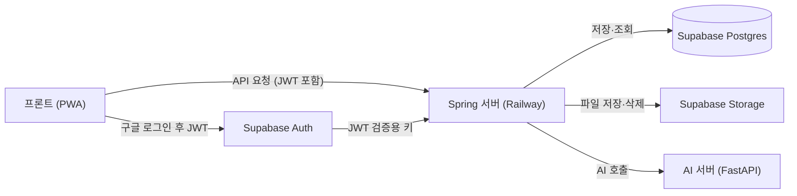

# 백엔드 개발 명세서 — 통학 AI 학습

최종 수정: 2026-11-06 · 기준: 기능명세서 최종본(2026-11-05 업데이트, 문서 버전 v1.3) + `#13`·`#10`·`#17` 머지 후 코드 동기화(`#18`) · 관련 문서: [AI 서버 ↔ 백엔드 API 명세](./AI_서버_백엔드_API_명세.md)

## 1. 개요와 범위

이 문서는 통학 AI 학습 앱의 백엔드(Spring) 구현 기준이다. 출처는 기능명세서 최종본(PDF·CSV), 팀 논의 결정표, AI 서버 API 명세다. 서비스는 사용자가 올린 강의자료를 AI가 단원으로 나누고, 통학 시간에 맞춘 요약본과 퀴즈를 제공한다. 플랫폼은 **PWA**다.

**백엔드 책임**

- 구글 로그인 JWT 검증, 사용자·통학 설정·과목·자료·단원·문제·세션·답안·오답 저장
- 자료 파일 저장·검증(형식·용량)과 만료·삭제(7일, 계정당 10개)
- AI 서버(FastAPI) 호출 중계와 실패 처리
- 학습 가능 시간·문제 수 계산, 진도·정답률·오답 집계, 질문 횟수 제한 강제

**백엔드 책임이 아닌 것**: 화면과 조작(스와이프 등), 기기 내 임시 저장(LN-07의 로컬 저장), TTS(LN-08, 기기 내장 TTS를 프론트가 호출), 프롬프트와 모델 선택(AI 담당).

### 범위

우선순위는 기능명세서 1장 총괄 표 기준이다.

| 우선순위 | 포함 기능 |
| --- | --- |
| P0 (MVP 필수) | AU-02 통학 시간·닉네임 설정, AU-04 구글 로그인, AU-05 로그인 유지·로그아웃, MT-01 과목 등록, MT-02 자료 업로드, MT-03 단원화·요약, CR-01\~04 단원 선택·양식·난이도·커리큘럼·복습 퀴즈, LN-01\~03 학습·O/X·객관식·단답형, LN-05 해설·근거 쪽수, **LN-06 AI 질문(하루 20회)**, LN-07 자동 저장·이어하기, RP-01\~04 통학 후 요약·정답률·오답노트·진도 |
| P0 (프론트만) | LN-08 TTS(기기 내장, 서버·AI 작업 없음) |
| P1 (시간 되면) | MT-04 족보·기출, CR-05 시험 D-Day, AU-01·AU-03 이메일 가입·로그인(MVP 제외) |
| P2 (이번에는 안 함) | LN-04 논술형·AI 채점, RP-05 유사 문제, RP-06 오답 분석, 비밀번호 재설정·탈퇴, 지하철 경로 API, 학습 스트릭·친구 비교, AI 질문 확장(유료) |
| 제외 | **NT-01 알림 전체**(권한 요청·발송·수신 설정). 11/4 결정으로 등교 시각도 받지 않는다 |

### 이번에 만들지 않는 것 (결정)

- **이메일 가입·로그인(AU-01, AU-03)**: 구글 로그인만 구현한다. 이메일은 앱 전체 동작 확인 후 추후 결정한다.
- **알림(NT-01)**: 푸시 구독·발송·알림 설정 API와 `commute_profile.departure_time`, `notify_enabled` 사용을 모두 하지 않는다.
- **논술형(LN-04)**: `ESSAY` 문제를 생성·출제하지 않고 AI-04를 호출하지 않는다. 문제 양식 선택은 O/X·객관식·단답형 세 가지다.
- **유사 문제(RP-05)**: 해설 화면에 유사 문제 버튼이 없다. 백엔드도 만들지 않는다.
- **출발역·도착역 계산**: 역 이름은 표시용으로만 저장하고 시간 계산이나 어떤 로직에도 쓰지 않는다.

## 2. 시스템 구성



프론트는 Supabase Auth에서 구글 로그인으로 JWT를 받고, 이후 모든 요청을 Spring 서버에 보낸다. Spring은 JWT를 검증하고 DB·Storage에 저장하며, AI 서버는 Spring만 호출한다. Spring 서버만 Railway에 배포하고, DB·Storage·Auth는 Supabase를 쓴다. AI 서버도 같은 Railway 프로젝트에 두고 내부망 주소로만 호출한다(8장).

## 3. 개발 환경·배포

백엔드는 Spring Boot 4.1.2 + Java 21 + Supabase Postgres이고, Railway에 배포한다. 아래 내용은 레포 `develop`(2026-11-04)의 `build.gradle`, `application.yaml`, `README.md`, `CONVENTION.md`, `db/migration` 기준이다.

### 스택

| 항목 | 내용 |
| --- | --- |
| 언어·빌드 | Java 21, Gradle |
| 프레임워크 | Spring Boot 4.1.2 (WebMVC, Validation, Actuator). `spring-boot-starter-data-jpa`는 스키마 검증(`ddl-auto: validate`)용으로만 쓰고, 쿼리는 `JdbcTemplate`로 짠다(3장 "DB 스키마 운영") |
| 보안 | Spring Security + OAuth2 Resource Server. Supabase JWT 검증 구현됨(`#13`) |
| DB | PostgreSQL (Supabase, 팀 공용 1개) |
| 마이그레이션 | Flyway (`src/main/resources/db/migration`) |
| 문서 | springdoc-openapi 3.2.0 (Swagger UI) |
| 기타 | Lombok |
| 스케줄링 | Spring `@Scheduled` (자료 만료, 고착 처리 정리). Railway 인스턴스 1개 기준 |
| AI 연동 | AI 서버(FastAPI)를 HTTP로 호출. 계약은 [AI 서버 ↔ 백엔드 API 명세](./AI_서버_백엔드_API_명세.md) |

### 로컬 실행

1. `.env.example`을 복사해 루트에 `.env`로 저장한다 (git 제외).
2. Supabase의 Connection pooling(Transaction mode, 6543 포트) 접속 정보를 `spring.datasource.*`에 채운다. `.env` 키는 **소문자 + 점 표기**다.
3. 마이그레이션용 5432(Session/Direct) 접속 정보를 `spring.flyway.url`, `.user`, `.password`에 채운다. 6543(Transaction pooling)은 Flyway의 advisory lock과 호환되지 않아 분리했다.
4. `./gradlew bootRun`으로 실행하고 Swagger로 확인한다. AI 서버를 붙일 때는 AI 레포를 로컬에서 `AI_MOCK=true`로 띄우고 `ai.server-url`, `ai.internal-key`를 맞춘다(합의 #10).
5. DB 비밀번호는 공개 채널이 아니라 팀원 간 별도 채널로 공유한다.

### Railway 배포

Railway Variables에는 **대문자 + 언더스코어** 표기를 쓴다. `PORT`는 Railway가 주입하고 `server.port: ${PORT:8080}`이 이를 반영한다. 빌드는 `./gradlew bootJar`다. AI 서버와 같은 Railway 프로젝트·환경에 두고 내부망으로만 호출한다.

| 변수 | 용도 | 상태 |
| --- | --- | --- |
| `SPRING_DATASOURCE_URL` / `_USERNAME` / `_PASSWORD` | Supabase DB 접속(6543 풀링) | 사용 중 |
| `SPRING_FLYWAY_URL` / `_USER` / `_PASSWORD` | 마이그레이션용 5432 접속 | 필요 |
| `AI_SERVER_URL` | AI 서버 주소. 예: `http://commute-study-ai.railway.internal:8000` (포트 포함) | 추가 예정, 이름은 합의 #10 |
| `AI_INTERNAL_KEY` | AI 서버의 같은 이름 변수와 **같은 값** | 추가 예정, 이름은 합의 #10 |
| JWT 검증용 설정 (issuer 또는 JWK set URL) | Supabase 로그인 토큰 검증 | 추가 예정, 값은 Supabase에서 확인 |
| Supabase Storage 접근 정보 | 자료 파일 저장·삭제·서명 URL 생성 | 추가 예정 |

Railway 파일 시스템은 재배포마다 초기화되므로 업로드 파일을 서버 디스크에 둔다고 가정하지 않는다(자료는 Storage에 저장).

### DB 스키마 운영 (확정)

Flyway로 관리하고 `spring.jpa.hibernate.ddl-auto`는 `validate`다. `V1__init_schema.sql`은 이미 적용됐으므로 **수정하지 않는다**(체크섬 불일치로 기동 실패). 변경은 `V2__...sql` 이후 파일로 추가한다. 사용자 테이블 이름은 예약어를 피해 `app_user`다. AI 연동과 최종 기능명세서에 필요한 V2 변경은 6장에 있다.

**저장 방식은 JPA Entity가 아니라 `JdbcTemplate`로 확정했다**(`#13` 구현 기준, `#18`). 컨트롤러에서 SQL을 직접 쓰지 않고 도메인 패키지(예: `user/UserRepository`)로 분리한다(슬라이스19, `#35`). `spring-boot-starter-data-jpa`는 의존성으로 남아 있고 `ddl-auto: validate`도 그대로 쓰지만, 이는 Flyway가 만든 스키마와 설정이 어긋나지 않는지 부트 단계에서 한 번 더 확인하는 용도이고 실제 쿼리는 `JdbcTemplate`로 짠다. Postgres 열거형(`material_status` 등)은 JPA 엔티티 매핑이 필요 없으므로, `JdbcTemplate`에서 문자열로 바인딩하거나 필요하면 `PGobject`로 다룬다.

### 브랜치·커밋 규칙 (CONVENTION.md)

- 기본 브랜치 `develop`, 직접 push 금지, PR로만 병합
- 작업 브랜치 `{Type}/#{이슈번호}` (예: `Feat/#9`), 이슈를 먼저 만든 뒤 시작
- 커밋 `[{Type}/#{이슈번호}] {Type}: {한글 작업 내용}`, 끝에 마침표 없음
- 이슈 제목 `[Feat] 작업 내용`

## 4. 인증·권한

로그인은 구글만 지원하고, 서버는 로그인을 직접 처리하지 않고 Supabase가 발급한 JWT만 검증한다. 이메일 가입·로그인은 이번 범위에서 제외한다(1장).

### 로그인 흐름 (구현 방침)

1. 프론트가 Supabase Auth로 구글 OAuth 로그인을 진행하고 JWT를 받는다.
2. 모든 API 요청에 `Authorization: Bearer <JWT>`를 붙인다.
3. Spring이 서명·만료를 검증하고 JWT의 `sub`(Supabase 사용자 UUID)를 사용자 식별자로 쓴다.
4. 로그인 직후 프론트가 `GET /api/users/me`를 호출한다. 서버는 사용자가 없으면 **자동 생성**하되 **닉네임은 비워 둔다**(구글 이름은 쓰지 않는다). 응답의 `status`로 프론트가 S-04(통학 시간·닉네임 설정) 또는 S-20(홈)으로 분기한다(AU-04).
5. 로그인 유지(AU-05)와 토큰 갱신은 Supabase 클라이언트가 맡는다. 서버는 만료된 토큰에 401을 주고, 로그아웃은 클라이언트에서 세션을 지우는 것으로 끝난다(서버 API 없음, 제안).

**현재 구현 상태(11/6)**: 위 4번(`GET /api/users/me`의 자동 생성·`status` 계산)은 아직 없다. 지금 있는 건 `GET /api/auth/me`(JWT의 `sub`/`email`만 그대로 반환, 자동 생성 없음, 토큰 검증 확인용 임시 엔드포인트)와 `PUT /api/users/me/nickname`(호출 시 `app_user` 행을 upsert로 자동 생성)이다. `GET /api/users/me`(자동 생성·`status`)는 슬라이스5(#20)에서 만들고, 그때 `GET /api/auth/me`는 `deprecated` 표시 후 프론트 이전이 끝나면 제거한다(슬라이스19, #35).

### 닉네임

- 닉네임은 최초 설정(S-04)에서 통학 시간과 함께 입력하고, 2\~10자 필수다. S-60 설정에서 통학 시간과 함께 수정할 수 있다(AU-02). 현재 `PUT /api/users/me/nickname`이 이 길이 검증(2~10자)을 포함해 구현돼 있다.
- 닉네임이 없는 사용자는 `AUTHENTICATED`다. `app_user.nickname`은 V2(#10)에서 null 허용으로 바뀌었다.
- 중복은 허용한다(제안). 구글 이름은 저장도 노출도 하지 않는다.

### 인증 상태

상태는 테이블에 저장하지 않고 `GET /api/users/me` 응답에서 데이터로 계산해 내려준다.

| 상태 | 의미 | 서버 판단 기준 |
| --- | --- | --- |
| `ANONYMOUS` | 미로그인, S-01로 유도 | JWT 없음·만료 (서버 응답 401) |
| `AUTHENTICATED` | 로그인 완료, 최초 설정(통학 시간·닉네임, 과목 등록) 미완료 | 닉네임·통학 설정이 없거나 과목이 없음 |
| `ACTIVE` | 로그인 + 최초 설정 완료 | 닉네임과 통학 설정이 있음(과목 유무는 무관) |

제약: 통학 시간과 과목이 없으면 커리큘럼을 만들 수 없다(세션 생성 API가 검사). 설정 변경은 S-60에서 한다.

### 접근 규칙

- 공개 경로는 Swagger와 `/actuator/health`뿐이고, 나머지는 인증이 필수다. `SecurityConfig`의 `anyRequest().permitAll()`은 `#13`에서 제거됐다(`anyRequest().authenticated()` + 공개 경로만 `permitAll`).
- 모든 리소스(과목·자료·세션·오답 등)는 요청자 소유인지 확인한다. 다른 사용자의 데이터는 404로 응답해 존재를 드러내지 않는다(제안).
- 운영에서 CORS는 프론트 도메인만 허용한다(도메인은 프론트와 확정).

### 보류·미정

- 이메일로 가입한 사람이 같은 메일의 구글로 로그인하는 경우: 이메일 로그인을 넣을 때 결정한다(결정사항 AU-04).

## 5. 설정값

문서마다 값이 다르거나 바뀔 수 있는 숫자는 코드에 박지 않고 설정값(`application.yaml` 또는 환경변수)으로 읽는다. 값이 바뀔 때 재배포만 하면 된다. 키 이름은 제안이다. 상태는 기능명세서 최종본(11/5) 기준이다.

### 학습·업로드·리포트

| 설정 | 키 (제안) | 기본값 | 상태 | 비고 |
| --- | --- | --- | --- | --- |
| 학습 가능 시간 | (설정 없음) | 입력한 편도 이동 시간 그대로 | 확정 | 비율을 고정하지 않는다. 안내 문구는 프론트 |
| 편도 이동 시간 범위 | `commute.min-minutes` / `max-minutes` | 10 / 120분 | 확정 | 벗어나면 400 |
| 닉네임 길이 | `user.nickname-min` / `-max` | 2 / 10자 | 확정 | |
| 커리큘럼 최소 학습 시간 | `study.curriculum-min-minutes` | 11분 | 확정 | 학습 가능 시간 기준. 11분 미만은 복습(REVIEW) |
| 요약본 읽기 시간 | `study.summary-minutes` | 3분 | 확정 | 커리큘럼 모드에서만 차감 |
| 문항당 소요 시간 | `study.minutes-per-question.ox` / `.mc` / `.short` | 0.5 / 1 / 1.5분 | 확정 | **유형별로만**, 난이도 가중 없음. 논술은 P2라 제외 |
| 세션당 문제 수 상한 | `study.max-questions-per-session` | 30 | 확정 | 다 풀고 시간이 남으면 '이어서 더 풀기'(새 세션) |
| 단원당 사전 생성 | `question.pregen-total` | 40문제, O/X·객관식·단답 균등 | 확정 | AI-02 1회 호출. 난이도는 미정(13장) |
| 단원·난이도별 문제 상한 | `question.max-per-category-difficulty` | 60개 | 확정(AI 서버 명세) | 닿으면 AI-02를 부르지 않고 이미 나온 문제를 다시 낸다 |
| 업로드 파일당 용량 | `upload.max-file-mb` | 30MB | 확정 | 백엔드가 업로드 단계에서 거부 |
| 업로드 쪽수·장수 | (AI 서버가 검사) | PDF·PPT 100쪽, 이미지(PNG·JPG) 20장 | 확정 | 파일을 열어야 알 수 있어 AI 서버가 `PAGE_LIMIT_EXCEEDED`로 돌려준다 |
| 허용 형식 | `upload.allowed-types` | PDF, PPTX, PNG, JPG | 확정 | 구버전 `.ppt`는 업로드 단계에서 막는다. DOCX·HWP·HEIC는 받지 않는다. JPG는 #66에서 추가 |
| 자료 보관 기간 | `material.retention-days` | 7일 | 확정 | 지나면 `EXPIRED` (원본 파일만 삭제) |
| 계정당 자료 수 | `material.max-per-user` | 10개 (계정 전체 기준) | 확정 | 넘으면 오래된 자료부터 `EXPIRED` |
| AI 질문 하루 한도 | `ai.question-daily-limit` | **20회** | 확정 | 꼬리질문·자유 질문 합산, 남은 횟수 표시, 실패 시 차감 안 함 |
| 정답률 그래프 최소 응답 수 | `report.min-answers` | 5개 | 확정 | 하루 응답 5개 미만인 날은 추이에서 **제외**(점을 찍지 않음) |
| 오답노트 목록 상한 | `wrongnote.max-open` / `.max-resolved` | 100 / 50개 | 확정 | 넘으면 오래된 것부터 **목록에서만 제외**, 기록·정답률은 유지 |
| 일 단위 시간대 | `app.timezone` | Asia/Seoul | 확정 | AI 질문 횟수·일별 정답률·이어하기 만료의 날짜 경계 |

### AI 서버 연동 (API 명세 기준)

| 설정 | 키 (제안) | 기본값 | 상태 | 비고 |
| --- | --- | --- | --- | --- |
| AI 서버 주소·내부 키 | `ai.server-url`, `ai.internal-key` | 환경변수 `AI_SERVER_URL`, `AI_INTERNAL_KEY` | 합의 #10 | 키는 로그에 남기지 않는다 |
| 동시 호출 수 | `ai.max-concurrency` | 3 | 합의 #2 | AI-01·AI-02 긴 호출의 동시 실행 수 |
| 호출 타임아웃 | `ai.timeout.{health,ai01,ai02,ai02-extra,ai03,ai05,ai06}` | 5 / 300 / 300 / 90 / 5 / 15 / 15초 | 합의 #6, #15 | AI-03은 사용자 기준 3초로 줄이자는 제안 |
| 서명 URL 유효시간 | `ai.signed-url-ttl-minutes` | 10분 | 합의 #1 | 호출·재시도마다 새로 만든다 |
| 처리 중 고착 정리 | `material.processing-timeout-minutes` | 10분 | 제안 | 이 시간을 넘은 `PROCESSING`은 `FAILED`로 정리 |
| 사전 생성 유형 비율 | `question.pregen-ratio` | OX 14, MC 13, SHORT 13 | 제안 | 40문제를 균등하게 나눈 값 |

## 6. 데이터 모델

실제 스키마는 `V1__init_schema.sql`(2026-11-03 리포 병합)다. 아래 표는 V1 기준이고, AI 서버 연동과 최종 기능명세서에 필요해 V2에서 바꿔야 할 것을 오른쪽 열에 적었다(근거는 [AI 서버 ↔ 백엔드 API 명세](./AI_서버_백엔드_API_명세.md) 11장과 이 문서 9장). 사용자 테이블 이름은 `app_user`이고 Supabase `auth.users`와 1:1이다. 테이블 이름은 소문자 스네이크케이스다.

### 테이블

| 테이블 | V1 컬럼 | V2에서 바꿀 것 |
| --- | --- | --- |
| `app_user` | id(uuid, `auth.users.id`를 참조), nickname, created\_at | `nickname` null 허용(필요 시). 구글 이름은 저장하지 않음 |
| `commute_profile` | user\_id, from\_station, to\_station, one\_way\_min, departure\_time, notify\_enabled | `from_station`, `to_station` null 허용(설정 API에서 선택값, 7장). `departure_time`, `notify_enabled`는 알림 제외로 쓰지 않는다(삭제는 선택) |
| `subject` | id, user\_id, name, exam\_date, created\_at | 없음 |
| `material` | id, subject\_id, file\_url, file\_type, kind, size, page\_count, status, error\_message, created\_at | `file_name`, `expires_at` 추가. status에 `EXPIRED` 추가. PNG 여러 장 저장 구조(합의 #3) |
| `category` | id, subject\_id, material\_id, name, page\_start, page\_end, summary, order | `question_status`(`PREPARING`/`AVAILABLE`) 추가 |
| `question` | id, category\_id, type, difficulty, stem, choices(jsonb), answer, accepted\_answers(jsonb), rubric(text), explanation, source\_page | `concept_tags jsonb`, `origin`(`PREGEN`/`EXTRA`) 추가. `rubric`은 P2라 그대로 둔다 |
| `session` | id, user\_id, category\_ids(bigint\[\]), question\_types(jsonb), difficulty, study\_min, mode, status, started\_at, ended\_at | `feedback text` 추가. `category_ids` null 허용(`source: wrong_notes`는 단원을 안 넘길 수 있음, 7장). 사용자당 `IN_PROGRESS` 1개를 막는 부분 유니크 인덱스 |
| `session_question` | session\_id, question\_id, order | 없음 |
| `attempt` | id, user\_id, question\_id, session\_id, answer, correct(null 허용), score(numeric), answered\_at | `self_judged boolean` 추가. `(session_id, question_id)` 유니크 |
| `wrong_note` | user\_id, question\_id, wrong\_count, status(`OPEN`/`RESOLVED`), last\_wrong\_at | 없음 |
| `ai_question_usage` | user\_id, date, count | 없음 |
| `material_page` | (V1에 없음) | **신규**: material\_id, page, text |

관계: `app_user` 1 — N `subject` 1 — N `material` / `category` 1 — N `question`. `material` 1 — N `material_page`. `app_user` 1 — N `session` N — N `question`(`session_question`). `attempt`는 session·question을 가리키고, `wrong_note`는 (app\_user, question)당 1행이다.

Flyway 주의: `ALTER TYPE material_status ADD VALUE 'EXPIRED'`는 같은 트랜잭션 안에서 그 값을 쓸 수 없으므로 별도 V 파일로 나눈다.

### 상태 전이

아래 상태값은 기능명세서 3장의 값이다.

**자료 처리 상태 (`material.status`)**

| # | 현재 | 트리거 | 다음 |
| --- | --- | --- | --- |
| M1 | (없음) | 업로드 성공 (MT-02) | `UPLOADED` |
| M2 | `UPLOADED` | 처리 시작 | `PROCESSING` |
| M3 | `PROCESSING` | 단원화·요약 완료 (AI-01) | `READY` |
| M4 | `PROCESSING` | 텍스트 인식 실패 또는 AI 응답 오류 | `FAILED` |
| M5 | `FAILED` | 사용자가 다시 시도 | `PROCESSING` |
| M6 | `READY` | 업로드 후 7일 경과 또는 계정 전체 자료 10개 초과(오래된 순) | `EXPIRED` |

`EXPIRED`는 원본 파일만 지운 상태이고 단원·요약본·문제·오답·`material_page`는 유지한다. 금지: `READY` → `PROCESSING`(완료된 자료는 다시 처리하지 않고 새로 업로드), `UPLOADED` → `READY`(단원화 없이 학습 불가), `EXPIRED` → 어떤 상태로도(재처리 불가). 용량 초과·형식 오류는 업로드 단계에서 거부되어 자료가 만들어지지 않는다.

**단원 문제 준비 상태 (`category.question_status`, 자료 `READY` 이후 단원별)**

| 값 | 의미 |
| --- | --- |
| `PREPARING` | 단원당 40문제 사전 생성 중(AI-02). 홈에서 "준비 중"으로 표시하고 선택 불가 |
| `AVAILABLE` | 40문제 생성 완료, 학습 가능 |

사전 생성이 끝내 실패하면 `PREPARING`으로 둔 채 다음 단원 목록 조회 때 1회 다시 시도한다(제안, 13장).

**학습 세션 상태 (`session.status`)**

| # | 현재 | 트리거 | 다음 |
| --- | --- | --- | --- |
| S1 | (없음) | 커리큘럼 생성 완료 (CR-03, CR-04) | `READY` |
| S2 | `READY` | 출발(학습 시작) | `IN_PROGRESS` |
| S3 | `IN_PROGRESS` | 앱 종료·화면 꺼짐 | `IN_PROGRESS` (상태 유지, 응답은 기기에 저장 LN-07) |
| S4 | `IN_PROGRESS` | 마지막 문제까지 응답 | `COMPLETED` |
| S5 | `IN_PROGRESS` | 중간 종료(그만하기), 도착 | `ENDED` |
| S6 | `IN_PROGRESS` | 이어하기 팝업에서 "새로 시작" | `ENDED` |
| S7 | `IN_PROGRESS` | 시작 후 다음 날(한국 시간 자정) 도래 | `ENDED` (자동 종료) |

금지: `COMPLETED`·`ENDED`는 다시 열지 않는다(이어 할 때는 새 세션 생성). 사용자당 `IN_PROGRESS`는 동시에 1개. 출발하지 않은 `READY`는 `COMPLETED`가 될 수 없다.

**오답 상태 (`wrong_note.status`)**

| # | 현재 | 트리거 | 다음 |
| --- | --- | --- | --- |
| W1 | (없음) | 문제 오답 | `OPEN` |
| W2 | `OPEN` | 다시 풀어 오답 | `OPEN` (wrong\_count + 1) |
| W3 | `OPEN` | 다시 풀어 정답 | `RESOLVED` |
| W4 | `RESOLVED` | 같은 문제를 다른 세션에서 다시 틀림 | `OPEN` |

금지: 사용자가 오답노트에서 삭제하지 않는다(틀린 기록은 정답률 그래프의 근거). 숨기기 기능도 없다. 상한(미해결 100·해결 50)을 넘으면 오래된 것이 목록에서만 빠진다(9.5).

## 7. API 명세

앱이 호출하는 백엔드 API다. xlsx API 명세를 기준으로 하되 JWT로 사용자를 알 수 있어 `/users/{id}/...`를 `/users/me/...`로 바꾸고 빠진 엔드포인트를 추가했다(**제안**). 모든 경로는 `/api` 접두어를 붙인다(`#13` 구현 기준). 열거형 값은 DB·AI 서버와 같은 대문자를 쓴다: `mode`는 `CURRICULUM`/`REVIEW`, `kind`는 `LECTURE`/`PAST_EXAM`, 문제 `type`은 `OX`/`MC`/`SHORT`이고 `difficulty`는 정수 1(하)·2(중)·3(상)이다. AI 서버 응답은 그대로 노출하지 않고 필요한 필드만 골라 내려준다(AI 호출 상세는 [AI 서버 ↔ 백엔드 API 명세](./AI_서버_백엔드_API_명세.md)). **사용자 API의 JSON 필드이름 표기는 camelCase로 확정했다**(13장, Spring/AI 서버 기본값과도 일치). 아래 예시는 모두 camelCase다. 모든 요청은 인증이 필요하고 공통 응답·에러 형식은 10장에 있다. 목록 API는 데이터가 적어 페이지네이션을 두지 않는다(제안).

### 인증·통학 설정

| 메서드 경로 | 기능 | 우선순위 | 요청 → 응답 |
| --- | --- | --- | --- |
| `GET /api/users/me` | AU-04, AU-05 · 내 정보. 없으면 자동 생성(닉네임 없음) | P0 | → `{userId, nickname?, status, settings?, hasSubject}` (status = `AUTHENTICATED` 또는 `ACTIVE`) (슬라이스5, #20에서 구현) |
| `PUT /api/users/me/settings` | AU-02 · 최초 설정과 S-60 수정. 닉네임과 통학 시간을 함께 저장 | P0 | `{nickname(2~10자), oneWayMin(10~120), fromStation?, toStation?}` → `{nickname, studyMin, mode}` (`studyMin` = `oneWayMin`) |
| `GET /api/users/me/settings` | AU-02 · 설정 화면(S-60) 조회 (제안) | P0 | → 저장된 설정 + `{studyMin, mode}` |

현재 구현된 것은 `GET /api/auth/me`(JWT 그대로 반환, 임시)와 `PUT`/`GET /api/users/me/nickname`(닉네임만, 4장 참고)이다. 위 표는 슬라이스5(#20), 슬라이스6(#21)에서 만들 목표 형태다.

### 과목·자료

| 메서드 경로 | 기능 | 우선순위 | 요청 → 응답 |
| --- | --- | --- | --- |
| `POST /api/subjects` | MT-01 · 과목 등록 | P0 | `{name(1~20자), examDate?}` → `{subjectId}` |
| `GET /api/subjects` | 내 과목 목록, 홈 상단 D-Day (CR-05) | P0 (D-Day는 P1) | → `{subjects:[{id, name, examDate?, dDay?}]}` (`dDay`는 시험일이 있고 아직 지나지 않았을 때만) |
| `POST /api/subjects/{id}/materials` | MT-02, MT-04 · 자료 업로드. 형식(`.pdf`, `.pptx`, `.png`, `.jpg`·`.jpeg`)과 30MB를 검증하고 Storage에 저장한 뒤 비동기로 AI-01을 부른다. 저장 직후 계정당 10개 초과분을 만료 처리한다 | P0 (`kind=PAST_EXAM`은 P1) | multipart `file`(PNG 여러 장은 합의 #3), `kind`(`LECTURE`/`PAST_EXAM`) → `{materialId, status}` |
| `GET /api/materials/{id}/status` | MT-03 · 처리 상태 폴링. AI 서버는 진행률을 주지 않아 `progress`는 없다 | P0 | → `{status, categoryCount, error?}` (`error` = AI 서버 `message`) |
| `POST /api/materials/{id}/retry` | MT-03 · `FAILED` 자료 재처리(M5) (제안) | P0 | → `{status}` |
| `GET /api/subjects/{id}/categories` | CR-01, RP-04 · 단원 목록·진도 | P0 | → `{categories:[{id, name, pageStart, pageEnd, progress, accuracy, lastStudiedAt, state, questionStatus}], recommendedId}` (`state` = 안 함/진행 중/완료, `questionStatus` = `PREPARING`/`AVAILABLE`) |
| `PATCH /api/categories/{id}` | MT-03 · 단원명 수정 (제안) | P1 | `{name}` → `{id, name}` |

단원 목록 화면(S-11)의 "완료" 버튼은 화면 이동만 하고 서버 호출이 없다고 본다(제안). 단원은 `READY`가 되는 시점에 이미 저장되어 있고, `questionStatus`가 `PREPARING`인 단원은 홈에서 "준비 중"으로 보이며 선택할 수 없다. 프론트는 `questionStatus`를 폴링으로 갱신한다.

### 커리큘럼·학습

| 메서드 경로 | 기능 | 우선순위 | 요청 → 응답 |
| --- | --- | --- | --- |
| `POST /api/sessions` | CR-01\~04 · 오늘의 커리큘럼 생성. 단원 복수 선택, 오늘만 시간 변경, '이어서 더 풀기'도 이 API를 쓴다 | P0 | `{source, categoryIds?, questionTypes, difficulty, studyMinOverride?, skipSummary?}` → `{sessionId, mode, studyMin, questionCount, summary?, shortage?, noReviewItems?, questions:[{id, type, stem, choices?, sourcePage}]}` |
| `GET /api/sessions/current` | LN-07 · 이어하기용 진행 중 세션. 시작 후 다음 날(KST)이 되었으면 `ENDED`로 바꾸고 204 | P0 | → `{sessionId, categoryNames, answered, total}` 또는 204 |
| `POST /api/sessions/{id}/start` | LN-01 · 출발, READY→IN\_PROGRESS (제안) | P0 | → `{status, startedAt}` |
| `POST /api/sessions/{id}/end` | LN-01 · 중간 종료·새로 시작, ENDED (제안) | P0 | `{reason}` (`QUIT`/`ARRIVED`/`NEW_START`) → `{status}` |
| `POST /api/attempts` | LN-02, LN-07 · 응답 일괄 전송 | P0 | `{sessionId, attempts:[{questionId, answer, correct?, selfJudged?, answeredAt}]}` → `{saved, progress, sessionStatus}` |
| `POST /api/answers/judge` | LN-03 · 단답형 판정(AI-03) | P0 | `{questionId, answer}` → `{correct, reason}`, 시간 초과·실패면 `{correct: null, timeout: true}` |
| `GET /api/questions/{id}/explanation` | LN-05 · 해설·개념·근거 쪽수 (제안) | P0 | → `{explanation, sourcePage}` |
| `POST /api/questions/{id}/ask` | LN-06 · AI 질문(AI-05). 응답은 SSE(`delta`/`done`/`error`). 꼬리질문 버튼 3개(왜 틀렸어? / 예시 더 / 쉬운 말로)와 자유 질문 모두 이 API다 | P0 | `{message, history?}` → `text/event-stream`, 남은 횟수는 `GET /api/users/me/ai-quota`로 확인 |
| `GET /api/users/me/ai-quota` | LN-06 · 오늘 남은 질문 횟수 ("오늘 17/20회") (제안) | P0 | → `{used, limit, remaining}` |

`POST /api/sessions`의 `source`는 `categories`(단원 선택) 또는 `wrongNotes`(오답노트 다시 풀기)다. 학습 가능 시간(`studyMinOverride`가 있으면 그 값, 없으면 통학 설정값)이 11분 미만이면 요청에 상관없이 `mode`가 `REVIEW`로 정해진다(9장).

- `studyMinOverride`: S-30의 "오늘만 시간 바꾸기"와 "이어서 더 풀기"(남은 시간)가 같이 쓴다. 저장된 통학 설정은 바꾸지 않는다.
- `skipSummary`: 이어서 더 풀기처럼 요약본을 이미 본 경우 요약본 3분을 차감하지 않는다(제안, 13장).
- TTS(LN-08)는 서버 API가 없다.

### 리포트·오답노트

| 메서드 경로 | 기능 | 우선순위 | 요청 → 응답 |
| --- | --- | --- | --- |
| `GET /api/subjects/{id}/report?scope=session&sessionId=` | RP-01 · 통학 후 요약 | P0 | → `{today:{minutes, solved, accuracy, wrong}, feedback?}` |
| `GET /api/subjects/{id}/report?scope=all` | RP-02 · 정답률 그래프 | P0 | → `{accuracyTrend:[{date, accuracy, answers}], byCategory:[{id, accuracy}], average}` (`byCategory`는 정답률 낮은 순) |
| `GET /api/subjects/{id}/wrong-notes?categoryId=` | RP-03 · 오답 목록(최근 오답 순, 미해결 최대 100·해결 최대 50) | P0 | → `{items:[{questionId, categoryId, stem, wrongCount, status, lastWrongAt}]}` |

오답노트 "다시 풀기"는 별도 API 없이 `POST /api/sessions`(`source: wrongNotes`)로 한다. 하루 응답이 5개 미만인 날은 서버가 `accuracyTrend`에서 빼고 점을 찍지 않는다. 클라이언트는 점이 2개 이상이면 선으로 잇고, 1개면 안내 문구를 보여준다.

### 결정이 필요한 API 설계 사항

- **정답을 세션 응답에 포함할지**: O/X·객관식은 0.3초 채점과 오프라인 저장(LN-07) 때문에 정답이 앱에 있어야 하므로 `answer`와 `explanation`을 세션 응답에 포함하고, 단답은 내려주지 않는 것을 제안한다. `POST /api/attempts`의 `correct`는 서버가 O/X·객관식은 다시 계산해 보정한다. (아직 미정)
- **일괄 전송 중복**: `(session_id, question_id)`당 응답은 1개만 저장하고 이미 있으면 무시한다(제안).
- **세션 전체 조회**: 이어하기에 `GET /api/sessions/{id}`(전체 문제와 푼 문제)가 필요한지.

## 8. AI 서버 연동

AI 서버(FastAPI, 별도 레포 `commute-study-ai`)는 DB 없이 백엔드만 호출하는 내부 API다. 요청·응답 형식, 에러 코드, 타임아웃, 합의 필요 항목은 [AI 서버 ↔ 백엔드 API 명세](./AI_서버_백엔드_API_명세.md)에 있고, 이 장은 백엔드가 지킬 것만 요약한다. 기준은 AI 서버 API 명세 **v0.3**(11/6 갱신, 정확한 `develop` 커밋은 `#18`에서 확인 중)이다. 기능명세서 5장의 지연은 기획 목표이고 실제 호출 제한은 아래 표(API 명세 2장)를 따른다.

| ID | 호출 | AI 서버 상태 | 명세서 목표(초) | 서버 상한 / 백엔드 타임아웃(초) | 백엔드 처리 |
| --- | --- | --- | --- | --- | --- |
| AI-01 | 단원화·요약 | 구현됨 | 30\~90 | 270 / 300 | 서명 URL로 파일 전달 → `category`·`material_page` 저장 → `READY`. 실패하면 `FAILED` |
| AI-02 | 문제·해설 생성 | 구현됨 | 60\~180 | 80 / 300(사전 생성), 90(부족분) | 단원 `READY` 직후 단원당 40문제 사전 생성, 부족분은 커리큘럼 생성 때 |
| AI-03 | 단답형 판정 | 구현됨 | 3 | 4 / 5 | 정규화 비교 후 불일치일 때만 호출. 실패하면 `timeout: true` |
| AI-04 | 논술형 채점 | mock | - | - | **P2, 호출하지 않는다** |
| AI-05 | AI 질문 (SSE) | **구현됨(AI 서버 `develop`, 11/5), Railway `main`에는 아직 mock만 배포** | 첫 글자 2, 전체 10 | 13 / 15 | SSE 중계. `done`을 받을 때만 횟수 차감. AI 담당이 `develop`을 배포해야 실제 모드 연동 가능 (13장) |
| AI-06 | 통학 후 피드백 | 구현됨 | 8 | 13 / 15 | 푼 문제가 있을 때만 세션당 1회. 실패하면 숫자 카드만 |

### 백엔드 호출 규칙

- AI 호출은 `AiClient` 인터페이스로 감싼다. **백엔드가 자체 mock 구현을 만들지 않는다.** AI 서버가 `AI_MOCK=true`(기본)로 고정 응답을 주므로 개발 중에는 AI 서버를 mock 모드로 띄워 쓴다. 실패 흐름은 `X-Mock-Error` 헤더로 시험하고, 단위 테스트는 가짜 HTTP 서버(`MockRestServiceServer` 등)로 한다.
- 요청에는 AI 서버가 정의한 필드만 담는다. 모르는 필드는 400 `INVALID_REQUEST`로 거부된다. 응답에 모르는 필드가 있으면 무시한다.
- 에러는 `{"error":{"code","message"}}` 한 가지 형태다. `message`는 `material.error_message`에 저장해 사용자에게 보여준다. 백엔드 타임아웃은 `AI_TIMEOUT`, 그 외 실패는 `AI_UNAVAILABLE`로 바꾼다(10장).
- AI 호출은 DB 트랜잭션 밖에서 하고 `spring.jpa.open-in-view: false`를 설정한다. 긴 호출(AI-01, AI-02)은 `@Async` 스레드에서 동시 3개까지 실행한다(합의 #2).
- 자료 파일은 Supabase Storage에 둔 뒤 **서명 URL**(유효시간 10분 제안)로 넘긴다. 호출마다 새로 만들고, `FILE_FETCH_FAILED`면 새 URL로 1회만 다시 호출한다(합의 #1). **만료된 자료의 파일은 이미 없으므로** AI-01 재호출은 하지 않는다.
- AI 서버는 상태가 없으므로 자료 쪽 텍스트(`material_page`)와 이전 대화는 매 요청에 담아 보낸다. 자료 원문과 내부 키는 로그에 남기지 않는다.
- AI-02 사전 생성은 요청 하나에 유형별 `count` 합계 40(OX 14, MC 13, SHORT 13)을 담아 1회 호출한다. 서버 상한 80초에 못 끝내면 `shortfall`이 오는데, 이때 부족분을 1회 더 요청한다(제안, 13장).

### AI 담당과 합의 필요 (우선 높음)

합의 항목 15개는 API 명세 12장에 있다. 연동 구현 전에 정해야 하는 것:

- **#1** 서명 URL 유효시간과 재서명
- **#3** PNG 여러 장을 한 자료로 받는 구조(V1 `material.file_url`은 1개)
- **#5** AI-02 사전 생성 규모(**40문제로 바뀜**, API 명세의 30문제를 수정 요청)와 난이도 구성(최종 명세서도 논의 필요)
- **#6** AI-03 시간 기준(사용자 3초 vs AI 4초·백엔드 5초)과 정규화 일치
- **#7** AI-06 요청에 지난 정답률 필드 추가
- **#9** AI-05 실제 구현 시점(**해소**: AI 서버 `develop`에 11/5 구현 완료. 남은 건 Railway `main` 배포 시점)
- **#10** 로컬 개발 접속과 환경변수 이름(**해소**: `AI_SERVER_URL`, `AI_INTERNAL_KEY`로 확정, `.env.example`에 반영)

## 9. 핵심 로직

기능명세서가 정한 계산과 처리 규칙을 백엔드 구현 기준으로 정리했다. 명세에 없어 보완한 규칙은 **(제안)**이다.

### 9.1 학습 가능 시간과 모드 (AU-02, CR-04)

```text
study_min = one_way_min          (또는 요청의 studyMinOverride)
```

- 학습 가능 시간은 사용자가 입력한 편도 시간(환승·도보를 뺀 지하철 탑승 시간) **그대로**다. 비율을 곱하지 않는다(확정).
- `study_min` ≥ 11이면 `CURRICULUM`, 11 미만이면 `REVIEW`(복습 퀴즈만)다. 예: 50분은 `CURRICULUM`, 10분은 `REVIEW`, 11분은 `CURRICULUM`.
- 편도 이동 시간은 10\~120분이고 벗어나면 400이다.
- 오늘만 시간을 바꾸는 경우(CR-02)는 `POST /api/sessions`의 `studyMinOverride`로 받고 저장된 통학 설정은 바꾸지 않는다.
- 역 이름(`from_station`, `to_station`)은 저장만 하고 계산에 쓰지 않는다.

### 9.2 문제 수 계산 (CR-03)

```text
question_count = min( 30, floor( (study_min - summary_min) / per_question_min ) )
```

- `summary_min`은 `CURRICULUM`에서만 3분을 빼고 `REVIEW`는 0이다(`skipSummary`이면 0).
- `per_question_min`은 **문제 유형별** 값(O/X 0.5, 객관식 1, 단답 1.5분)이고 **난이도는 시간에 영향을 주지 않는다**(확정). 유형을 여러 개 고르면 **균등하게 섞고 선택한 유형의 평균**을 쓴다.
- 세션당 상한은 30문제다. 30문제를 다 풀고 시간이 남으면 프론트가 '이어서 더 풀기'로 새 세션(`POST /api/sessions`, 같은 단원 또는 다음 단원, 남은 시간을 `studyMinOverride`로)을 만든다.
- 예: 50분·객관식 → (50 − 3) ÷ 1 = 47이지만 상한으로 **30문제**. 30분·객관식 → 27문제. 20분·객관식+단답(평균 1.25) → 13문제(소수점 버림). `REVIEW` 10분·객관식이면 10문제다.

### 9.3 문제 선택과 분량 부족 (CR-03)

- 선택한 단원(복수 가능)의 `question` 중 유형과 난이도(정수 1\~3)가 맞는 것을 고른다. 순서는 **안 푼 문제 → 오답 문제 → 부족하면 AI가 이미 푼 문제와 겹치지 않게 추가 생성**이다. 유형은 균등하게 섞는다.
- 추가 생성은 AI-02로 **부족분만** 요청한다(백엔드 타임아웃 90초). `count` 합 40 이하로 나눠 부르고, `excludeStems`에는 이미 있는 문제 지문(최근 60개)을 담는다. 추가 생성 문제는 `origin = EXTRA`로 저장한다.
- 단원·난이도별 문제가 **60개**가 되면 더 요청하지 않고 이미 나온 문제를 다시 낸다(백엔드가 확인).
- `question_status`가 `PREPARING`인 단원은 선택할 수 없다. 이미 선택된 요청이 오면 422 `CATEGORY_NOT_READY`다. 사전 생성 중인 단원에는 부족분도 요청하지 않는다(같은 문제를 중복 생성하게 된다).
- **자료가 `EXPIRED`인 단원은 추가 생성을 하지 않는다**(명세). 있는 문제로만 구성하고 부족하면 아래 `shortage`로 안내한다.
- AI-02가 `shortfall`을 주거나 실패해도 있는 문제로만 세션을 만든다. 문제가 0개이면 세션을 만들지 않고 실패를 안내해 사용자가 다시 시도하게 한다.
- 그래도 목표보다 적으면 응답에 `shortage:{target, available, all_solved}`를 담아 내린다. 클라이언트가 묻는다.
    - 문제가 남은 단원이 있으면: "다음 단원 추가하기" / "이 단원만 풀기". 추가를 고르면 단원을 늘려 세션을 다시 만든다. 출발하지 않은 이전 `READY` 세션은 삭제한다(제안).
    - 단원 문제를 모두 푼 경우(`all_solved: true`): "다음 단원 풀기" / "새 자료 올리기" / "학습 끝내기".
- `REVIEW` 모드는 요약본 없이 **오답노트(`OPEN`) → 이미 푼 문제 순**으로 채운다. 신규 사용자(푼 문제가 없음)는 새 단원을 풀 수 없으므로 `questions`를 비우고 짧은 요약본 1개와 `noReviewItems: true`를 내려준다(팀 결정). 복습 대상의 정확한 범위는 13장.
- 모든 문제는 업로드한 자료 범위 안에서만 만들고 `source_page`가 있어야 한다. AI-02가 검증하고, 백엔드는 `source_page`가 단원 쪽 범위 안인지 방어적으로 확인한다. 근거 쪽수가 없는 문제·해설은 저장하지 않고 재생성 대상으로 로그만 남긴다(LN-05).

### 9.4 자료 업로드와 단원화 비동기 처리 (MT-02, MT-03)

1. **검증**: 확장자(`.pdf`, `.pptx`, `.png`, `.jpg`·`.jpeg`)와 Content-Type, 파일당 30MB를 확인해 실패하면 종류별 다른 에러 코드로 400을 준다(자료는 만들지 않는다). 이미지는 PNG·JPG를 섞어 최대 20장이다. 쪽수(PDF·PPT 100)는 AI 서버가 판단한다.
2. **저장**: 파일을 Supabase Storage에 사용자별 경로로 저장하고 `material`을 `UPLOADED`로 만들며 `expires_at = 업로드 + 7일`을 기록한다. 업로드 응답은 여기까지만 하고 즉시 돌려준다.
3. **자료 수 정리**: 저장 직후 계정 전체 자료가 10개를 넘으면 가장 오래된 `READY` 자료부터 만료 처리한다(9.11). 처리 중(`UPLOADED`/`PROCESSING`) 자료는 건드리지 않는다.
4. **비동기 작업**: 별도 스레드에서 `PROCESSING`으로 바꾸고 서명 URL을 만들어 AI-01을 호출한다(`fileUrls`: PDF·PPT는 1개, 이미지(PNG·JPG)는 쪽 순서대로 여러 개). 사용자가 화면을 나가거나 앱을 닫아도 서버에서 계속 진행된다.
5. **결과 저장**: `pageCount`, `pages`(`material_page`), `categories`(`category`, `material_id` 포함)를 한 트랜잭션으로 저장하고 `READY`로 바꾼다. 각 단원의 `question_status`는 `PREPARING`이다. `pageStart ≤ pageEnd ≤ pageCount`를 방어적으로 확인한다.
6. **실패**: `UNSUPPORTED_FILE`, `PAGE_LIMIT_EXCEEDED`, `TEXT_EXTRACTION_FAILED`, `LLM_FAILED`, `LLM_TIMEOUT`은 `FAILED`이고 AI 서버 `message`를 `error_message`에 저장한다. `FILE_FETCH_FAILED`는 서명 URL을 새로 만들어 1회만 다시 호출하고 또 실패하면 `FAILED`다.
7. **재시도**: 사용자가 다시 시도하면 `PROCESSING`으로 되돌리고 같은 파일로 1회 호출한다. `READY`·`EXPIRED` 자료는 다시 처리할 수 없다(409).
8. **재시작 복구**: 서버 재시작으로 호출이 끊긴 자료는 `PROCESSING`에 남는다. 10분이 넘은 `PROCESSING`을 `FAILED`로 정리한다(제안).
9. **문제 사전 생성**: `READY` 직후 단원별 AI-02를 백그라운드로 호출해 단원당 40문제(`origin = PREGEN`)를 저장하고 `question_status`를 `AVAILABLE`로 바꾼다.

### 9.5 응답 저장·오답 등록·세션 종료 (LN-02, LN-07, RP-03)

- `POST /api/attempts`는 일괄 전송이고 한 트랜잭션으로 저장한다. `(session_id, question_id)`가 이미 있으면 건너뛴다.
- O/X·객관식은 서버가 정답과 비교해 `correct`를 보정한다. 단답형은 판정 API 결과 또는 사용자가 고른 자가 판정(`self_judged: true`)을 받는다.
- 저장하면서 오답이면 `wrong_note`를 만들거나 `wrong_count`를 1 올리고 `OPEN`으로 둔다. 오답노트 다시 풀기에서 정답이면 `RESOLVED`로 바꾼다(목록은 유지). 오답노트 다시 풀기의 응답도 `attempt`로 저장하고 정답률에 포함한다.
- **목록 상한**: 오답 목록은 미해결(`OPEN`) 최근 100개, 해결(`RESOLVED`) 최근 50개(`last_wrong_at` 기준)만 내려준다. 넘은 행은 지우지 않고 목록에서만 뺀다. 정답률 계산에는 모든 `attempt`를 쓴다. "오답노트 다시 풀기"는 목록에 보이는 `OPEN`만 모은다.
- 세션의 모든 문제에 응답이 있으면 `COMPLETED`로 바꾸고, 중간 종료는 `/end`로 `ENDED`로 바꾼다. 한 사용자에게 `IN_PROGRESS`가 이미 있을 때 새 세션을 시작하면 기존 세션을 `ENDED`로 처리한다("새로 시작", `reason: NEW_START`). 부분 유니크 인덱스(`status = 'IN_PROGRESS'`, 사용자당 1개)로 동시 요청에서도 2개가 생기지 않게 한다.

### 9.6 이어하기 (LN-07)

- 클라이언트가 응답마다 기기에 저장하고 연결되면 일괄 전송한다. 서버는 `IN_PROGRESS` 세션과 이미 저장된 응답 수로 "직전 문제"를 알려준다. **타이머는 이어할 때 새로 시작**하므로 서버는 남은 시간을 보관하지 않는다.
- `GET /api/sessions/current`를 부를 때 세션의 `started_at`이 오늘(KST)보다 이전 날짜이면 `ENDED`로 바꾸고 204를 준다(S7, 지연 처리). 별도 배치는 필요 없다. `ENDED`로 끝난 세션은 이어하기 팝업이 뜨지 않는다.
- S7로 끝난 세션도 푼 문제가 있으면 통학 후 요약은 만들 수 있으나, AI-06은 호출하지 않는다(사용자가 요약 화면을 보지 않음, 9.8).

### 9.7 단답형 판정 (LN-03)

1. 백엔드가 답(최대 30자)을 정규화해 `accepted_answers`와 비교한다. 정규화는 AI 서버와 같은 규칙(유니코드 NFKC 후 소문자, 공백·문장부호 제거)을 쓴다. 일치하면 AI 호출 없이 정답이다.
2. 다르면 AI-03을 호출한다(`stem`, `acceptedAnswers`, `explanation`, `userAnswer`). 시간 안에 오면 `{correct, reason}`를 돌려준다.
3. 시간 초과·실패면 `{correct: null, timeout: true}`로 응답하고, 사용자가 대표 정답을 보고 맞음·틀림을 고른다. 자가 판정 결과도 정답률에 포함하고 `attempt.self_judged`에 저장한다.
4. 시간 기준(사용자 3초 vs AI 4초·백엔드 5초)은 합의 #6다.

### 9.8 진도·정답률 집계 (CR-01, RP-02, RP-04)

```text
progress = 처음 생성한 40문제 중 푼 서로 다른 문제 수 / 처음 생성한 문제 수 (보통 40)
```

- 상태: 사전 생성 중이면 **준비 중**, 0이면 안 함, 0보다 크고 1 미만이면 진행 중, 1이면 완료(처음 생성한 40문제를 모두 푼 상태). 분모는 `origin = PREGEN`인 문제 수라 추가 생성이 진도를 줄이지 않는다.
- 단원 정답률 = 단원 전체 응답 중 정답 비율(채점 대기 제외, 자가 판정 포함).
- **하루 정답률 = 그날 정답 ÷ 그날 응답**이고 오답노트 다시 풀기 응답을 포함하며 날짜는 `Asia/Seoul` 자정 기준이다. **하루 응답이 5개 미만인 날은 추이에서 제외**해 점을 찍지 않는다(확정). 점이 2개 이상이면 선으로 잇고 1개면 안내 문구를 보여주는 것은 클라이언트가 응답의 점 개수로 결정한다. 평균 정답률은 응답에 `average`로 준다.
- 단원별 정답률은 낮은 순으로 정렬해 내려준다(RP-02).
- 이어서 할 단원 추천: 진행 중인 단원 중 마지막 학습이 가장 최근인 것, 없으면 안 한 단원을 순서대로(CR-01). 마지막 학습 단원 기록은 `attempt`의 최근 응답에서 구한다(RP-04).

### 9.9 통학 후 요약 (RP-01)

- 숫자 4개(학습 시간, 푼 문제, 정답률, 담긴 오답 수)는 즉시 계산해 내려준다. 학습 시간은 출발부터 마지막 응답 시각까지다(제안).
- 피드백은 AI-06으로 만든다. 호출 조건: 세션이 `COMPLETED` 또는 `ENDED`이고, 푼 문제(`answered`)가 1개 이상이며 "새로 시작"으로 끝난 세션이 아니어야 한다.
- 요청은 `sessionId`, `mode`, `total`, `answered`, `correct`, `correctConcepts`, `wrongItems`(지문과 개념 태그)다. 시간 안에 오지 않으면 `feedback: null`로 내려 숫자 카드만 보여준다. 생성된 피드백은 `session.feedback`에 저장해 세션당 1회만 호출한다.
- "지난번보다 정답률이 %p 올랐어요" 같은 비교는 AI-06 요청에 이전 정답률 필드가 있어야 가능하다(합의 #7). 없으면 비교 없이 만들어진다.

### 9.10 AI 질문 횟수 (LN-06)

- 하루 한도는 **20회**(꼬리질문과 자유 질문 합산, 확정)이고 `ai_question_usage`의 조건부 증가로 서버에서 강제한다. 날짜는 한국 시간 자정에 초기화한다. 한도가 찬 날은 429 `AI_QUESTION_LIMIT`이고 프론트는 "내일 다시 질문할 수 있어요"를 보여준다.
- 차감은 AI-05에서 `done` 이벤트를 받았을 때만 한다. 실패하면 차감하지 않는다.
- 사용자당 진행 중인 질문은 1개로 제한한다. 진행 중에 새 요청이 오면 409로 거부한다(제안).
- 자료 범위 밖 질문은 AI가 "자료에 없는 내용이에요"로 답한다. 이 답에도 횟수는 차감된다(`done`을 받았으므로, 제안).
- 질문 대상 단원 자료는 `material_page`에서 읽어 보내므로 자료가 `EXPIRED`여도 질문은 가능하다.

### 9.11 자료 만료와 삭제 (MT-02, M6)

- 두 조건 중 하나라도 맞으면 자료를 `EXPIRED`로 바꾼다: ① 업로드 후 7일 경과, ② 계정 전체 자료가 10개를 넘을 때 오래된 순.
- 만료 처리: Storage의 원본 파일(PNG는 모든 장)을 삭제하고 `file_url`을 비운 뒤 `status = EXPIRED`로 바꾼다. **단원·요약본·문제·오답·`material_page`는 그대로 둔다**(명세).
- 실행 시점: ① 업로드 직후 10개 초과분(9.4의 3단계), ② `@Scheduled` 하루 1회(KST 새벽)의 7일 경과분. Storage 삭제가 실패하면 상태를 바꾸지 않고 다음 실행에서 다시 한다.
- 만료된 자료의 단원은 그대로 학습할 수 있지만 문제를 **추가 생성할 수 없다**(9.3). 재처리(`retry`)도 불가능하다. 다시 하려면 새로 업로드한다.
- 개수 기준에 `FAILED`·`UPLOADED`·`PROCESSING` 자료를 포함할지는 13장(임시: `READY`·`FAILED`만 센다).

### 9.12 시험 D-Day (CR-05, P1)

- 시험일이 있는 과목만 `d_day = 시험일 − 오늘(KST)`를 내려준다. 시험일이 오늘이면 0(D-Day), 지났으면 `d_day`를 내려주지 않는다. 남은 통학 횟수와 미완료 단원 수는 계산하지 않는다(11/4 결정으로 삭제). 등교 요일 입력이 필요 없어졌다.

## 10. 공통 규칙

이 장의 형식은 모두 **(제안)**이며 프론트와 합의 후 확정한다. 이 규칙은 포맷이 다른 API가 생기지 않도록 공통 뼈대 이슈에서 먼저 구현한다.

### 응답과 에러 포맷

- 성공 응답은 래퍼 없이 리소스 JSON을 그대로 내려준다(7장의 응답 형태 그대로). 생성은 201, 본문 없음은 204.
- 에러는 `{code, message, details?}` 한 가지 형태로 내려준다. 사용자에게 보여줄 문구는 프론트가 `code`로 정하고, 최대 용량 같은 숫자는 `details`에 담는다. `message`는 개발자용이다.

| HTTP | code | 쓰는 경우 |
| --- | --- | --- |
| 400 | `VALIDATION_ERROR` | 입력 형식·범위 오류 (과목명 1\~20자, 닉네임 2\~10자, 편도 10\~120분, 답 길이 등) |
| 400 | `UNSUPPORTED_FILE_TYPE` | 지원하지 않는 확장자 |
| 400 | `FILE_TOO_LARGE` | 파일 용량 초과 (`details`에 한도). 쪽수·장수 초과는 자료 `FAILED`로 알린다 |
| 401 | `UNAUTHORIZED` | JWT 없음·만료·검증 실패 |
| 404 | `NOT_FOUND` | 없는 리소스, 다른 사용자의 리소스 |
| 409 | `STATE_CONFLICT` | 금지된 상태 전이 (완료·만료된 자료 재처리, 끝난 세션 재사용, 진행 중 질문 중복 등) |
| 422 | `MATERIAL_NOT_READY` | 단원화가 끝나지 않은 자료로 학습·커리큘럼 요청 |
| 422 | `CATEGORY_NOT_READY` | 문제 사전 생성이 끝나지 않은(`PREPARING`) 단원으로 커리큘럼 요청 |
| 422 | `SETUP_REQUIRED` | 통학 설정·닉네임 또는 과목 없이 커리큘럼 생성 요청 |
| 429 | `AI_QUESTION_LIMIT` | AI 질문 하루 한도(20회) 초과 |
| 502 / 504 | `AI_UNAVAILABLE` / `AI_TIMEOUT` | AI 서버 오류·지연. 8장의 실패 시 동작을 함께 내려줌 |
| 500 | `INTERNAL_ERROR` | 그 외 (스택 트레이스는 응답에 넣지 않음) |

### 검증과 입력

- 입력 검증은 Bean Validation으로 한다. 숫자 제한은 5장 설정값을 쓴다.
- 기본 `multipart` 크기 제한은 작아서 업로드 한도보다 크게 올려야 한다(`spring.servlet.multipart.max-file-size`, `max-request-size`). 없으면 업로드 한도와 상관없이 프레임워크가 먼저 거부한다.

### 시간·ID

- DB에는 UTC로 저장하고, API는 ISO-8601(오프셋 포함)로 주고받는다. 하루 단위 집계(정답률, AI 질문 횟수), 이어하기 만료, D-Day의 경계는 `Asia/Seoul` 자정이다.
- `user.id`는 Supabase UUID이고, 나머지 테이블 ID는 자동 증가 정수를 쓴다(제안). 다른 사용자의 ID를 넣어도 소유자 확인으로 막는다(4장).

### 로깅

- 에러와 AI 호출 실패를 남긴다(8장). JWT, 비밀번호, 자료 원문, 사용자 답안은 로그에 남기지 않는다.
- 현재 `application.yaml`에 `show-sql: true`가 켜져 있다. 개발에만 켜고 운영에서는 끄는 프로파일 분리가 필요하다.

### 보안

- 비밀 값(DB 비밀번호, AI 서버 키, Supabase 키)은 환경변수로만 두고 저장소에 올리지 않는다. 키만 `.env.example`에 적는다.
- 업로드는 확장자와 Content-Type을 함께 확인하고, Storage 경로에 사용자 ID를 넣어 분리한다. 파일은 공개 URL이 아니라 서명 URL로만 제공한다(제안).
- CORS는 프론트 도메인만 허용한다. Swagger는 개발과 데모에서 쓰고, 운영 노출 여부는 결정한다(13장).

## 11. 개발 순서와 이슈 매핑

**(11/6 전면 갱신)** 이슈는 "슬라이스" 20개(#16\~#36, 상위 `#1`)로 재설계됐다. 기존 `#5`(공통 응답·예외 처리)·`#6`(AI 연동 클라이언트)은 각각 `#17`·`#19`로 흡수됐다(내용이 더 구체적이다). 담당은 **유소영(`1028ragon`)**과 **김동현(`Donghyun1221`)** 둘이다.

| 슬라이스 | 내용 | 번호 | 상태 | 담당 | 선행 |
| --- | --- | --- | --- | --- | --- |
| 기반 | Railway 배포·헬스체크 | #2 | 완료 | - | - |
| 기반 | ERD·Flyway 초기 스키마 | #3 | 완료 | - | - |
| 기반 | 개발용 시드 데이터 | #4 | 완료 | - | - |
| 기반 | V2 마이그레이션(AI 연동 스키마 보완, 6장) | #10 | 완료 | 유소영 | #3 |
| 기반 | 구글 로그인 인증 연동 + 닉네임 API(JdbcTemplate, 임시 구조) | #13 | 완료 | 김동현 | - |
| 1 | CORS: POST·PATCH·DELETE 허용 | #16 | 열림 | 김동현 | - |
| 2 | 공통 에러 포맷·설정값 구조 (옛 `#5`) | #17 | PR 올라감(#37) | 유소영 | - |
| 3 | 개발 명세서·README를 현재 코드와 동기화 | #18 | 진행 중 | 유소영 | - |
| 4 | AI 서버 연동 클라이언트 (옛 `#6`) | #19 | 열림 | 유소영 | #17 |
| 5 | 로그인 시 내 정보 조회·사용자 자동 생성 | #20 | 열림 | 김동현 | - |
| 6 | 닉네임·통학 시간 설정 저장 | #21 | 열림 | 김동현 | #20 |
| 7 | 과목 등록·목록 | #22 | 열림 | 김동현 | - |
| 8 | 자료 업로드 → 단원화 저장 | #23 | 열림 | 김동현 | V2(#10), #19 |
| 9 | 단원별 문제 사전 생성 | #24 | 열림 | 유소영 | #19, #23 |
| 10 | 오래된 자료 자동 정리 | #25 | 열림 | 김동현 | #23 |
| 11 | 단원 목록 진도·정답률·해설 조회 | #26 | 열림 | 김동현 | #24 |
| 12 | 오늘의 커리큘럼 생성 | #27 | 열림 | 유소영 | #21, #24 |
| 13 | 답안 저장·이어하기 | #28 | 열림 | 유소영 | #27 |
| 14 | 단답형 AI 판정 | #29 | 열림 | 유소영 | #19, #28 |
| 15 | 통학 후 AI 피드백 저장 | #30 | 열림 | 유소영 | #19, #28 |
| 16 | AI 질문 하루 20회(SSE) | #31 | 열림 | 김동현 | #19 |
| 17 | 통학 후 요약·정답률 그래프 | #32 | 열림 | 김동현 | #30 |
| 18 | 오답노트 | #34 | 열림 | 김동현 | #28 |
| 19 | 기존 인증·닉네임 코드를 공통 구조로 정리 (`#13` 후속) | #35 | 열림 | 김동현 | #17 |
| 20 | 실제 AI 모드로 전체 흐름 통합 검증 | #36 | 열림 | 유소영, 김동현 | P0 슬라이스 전부 |

### 공용 파일 소유권 (`#18` 결정)

같은 파일을 두 사람이 동시에 고치다 충돌하는 걸 막기 위한 규칙이다.

| 파일/디렉터리 | 담당 |
| --- | --- |
| `config/SecurityConfig`, `config/CorsConfig` | 김동현 |
| `common/*`, `application.yaml` 신규 키, `build.gradle` | 유소영 |
| Flyway `V4__` 이후 | 김동현만 작성, 만들기 전에 팀에 공유 |
| 도메인별 `ErrorCode` | 각 도메인 패키지에서 `ErrorCode`를 구현해 추가(한 파일에 몰지 않기) |

### 패키지 구조 (`#18` 정리)

레이어 기준(`common/`, `config/`)과 도메인 기준(`{domain}/`)을 섞어 쓴다. `common/`은 여러 도메인이 공유하는 횡단 관심사(에러 처리, 설정값, 유틸, 이벤트)만 두고, 도메인 로직은 전부 `{domain}/`(예: `user/`, `subject/`, `material/`, `category/`, `question/`, `session/`, `report/`, `wrongnote/`) 아래 `controller`/`service`/`repository`로 쪼갠다. 지금 `controller/`에 있는 `AuthController`·`NicknameController`는 `#35`에서 `user/`로 옮긴다 — 그 전까지는 다른 슬라이스가 `controller/`에 새 컨트롤러를 추가하지 않는다.

### 슬라이스가 맞물리는 지점

- **V2(#10)·구글 로그인(#13)은 이미 머지됐다.** 둘 다 기반 작업이라 이후 모든 슬라이스가 이 위에서 시작한다.
- **`#17`(공통 에러·설정)을 가장 먼저 머지**한다. 다른 슬라이스가 각자 에러 처리·설정값을 임시로 만들면 나중에 전체 리팩토링 충돌이 난다. `#19`(AI 클라이언트)는 `#17`에 막혀 있다.
- **`#23`(자료 업로드→단원화) PR이 머지된 뒤에 `#24`(문제 사전 생성)·`#26`(단원 목록)을 시작**한다. 같은 `category`/`material` 도메인 `Repository`를 다른 시점에 수정하면 충돌난다.
- **AI 실제 모드 전환**: AI-01·02·03·06은 AI 서버에 이미 구현이 있어 `AI_MOCK=false`로 바꾸면 된다. **AI-05(AI 질문)는 AI 서버 `develop`에 11/5 구현이 끝났지만 Railway(`main`)에는 아직 mock만 배포돼 있다.** AI 담당이 배포하기 전까지는 `#31`도 mock으로만 개발한다.
- **통학 시간 계산**(학습 가능 시간·모드, `common/study/StudyMode`)은 `#21`(통학 설정)과 `#27`(커리큘럼 생성)이 같은 유틸을 쓴다.

### P0 최소 데모 경로

구글 로그인 → 닉네임·통학 시간 설정 → 과목 등록 → 자료 업로드·단원화 → 단원 선택(준비 중 대기) → 커리큘럼 생성 → 문제 풀이 → 통학 후 요약·오답노트. 팀의 일정 신호는 "2주 안에 자료 업로드, 문제 생성, 학습 화면, 정답률 그래프"다. 위 슬라이스 1\~18이 이 경로를 이룬다.

## 12. 완료 체크리스트

기능명세서의 완료 기준과 위 장들의 규칙을 검증 가능한 항목으로 풀었다. 이슈의 완료 조건은 여기서 해당 항목을 가져간다. 시간 수치는 서버가 담당하는 구간 기준이다.

### 기능 (P0)

- [ ] 유효한 JWT로 `GET /api/users/me`를 호출하면 사용자가 닉네임 없이 자동 생성되고(`AUTHENTICATED`), 토큰이 없거나 만료되면 401이다
- [ ] 닉네임 2\~10자와 편도 10\~120분으로 설정을 저장하면 `study_min`이 입력값과 같다. 50분·11분은 `CURRICULUM`, 10분은 `REVIEW`이고 범위 밖(9분, 121분)이나 닉네임 1자·11자는 400이다
- [ ] 과목명 1\~20자, 시험일은 없어도 저장된다
- [ ] 지원하지 않는 형식(구버전 `.ppt` 포함)과 30MB 초과가 각각 다른 에러 코드로 거부되고, 쪽수 초과는 AI 서버 `PAGE_LIMIT_EXCEEDED`로 자료가 `FAILED`가 된다
- [ ] 자료가 `UPLOADED` → `PROCESSING` → `READY`(실패 시 `FAILED`)로 바뀌고 상태 API로 확인되며, `FAILED`는 재시도할 수 있다
- [ ] 단원화 결과가 `category`와 `material_page`에 저장되고 모든 단원에 쪽 범위가 있다. 60쪽 PDF 기준 3분 안에 끝난다(실제 AI)
- [ ] 단원이 생기면 단원당 40문제 사전 생성이 백그라운드로 시작되어 `question_status`가 `PREPARING` → `AVAILABLE`로 바뀌고, `PREPARING` 단원으로 세션을 만들면 422다
- [ ] 단원 목록에 진도(푼 문제 ÷ 40)·정답률이 나오고 이어서 할 단원이 추천된다
- [ ] 단원을 여러 개 골라 세션을 만들 수 있다
- [ ] 객관식 30분이면 문제 27개, 50분이면 상한 30개이고, 유형을 섞으면 평균 시간으로 계산한다. 사전 생성된 문제로 세션 생성이 3초 안에 끝난다
- [ ] 문제가 모자라면 안 푼 문제 → 오답 → 중복 없는 추가 생성 순으로 채워지고, `EXPIRED` 자료의 단원은 추가 생성하지 않는다
- [ ] 학습 가능 11분 미만이면 요약본 없이 오답노트(`OPEN`) → 이미 푼 문제 순으로 채워지고, 푼 문제가 없으면 `noReviewItems: true`다
- [ ] 응답 일괄 전송을 같은 내용으로 두 번 보내도 응답이 중복 저장되지 않는다
- [ ] 틀린 문제가 즉시 오답노트에 `OPEN`으로 쌓이고, 다시 풀어 맞히면 `RESOLVED`가 되며 목록에 남는다. 목록은 미해결 100개·해결 50개를 넘지 않는다
- [ ] 단답형은 정규화 비교가 일치하면 AI 없이 정답이고, 다르면 AI-03으로 판정하며, 시간이 넘으면 `{correct: null, timeout: true}`를 준다
- [ ] 모든 해설에 근거 쪽수가 있고, 없는 문제·해설은 저장되지 않는다
- [ ] 앱을 다시 열면 `IN_PROGRESS` 세션이 내려오고 직전 문제부터 이어진다. 시작 다음 날(KST)에는 204이고 세션이 `ENDED`다. 한 사용자에게 `IN_PROGRESS`가 2개 생기지 않는다
- [ ] 세션 종료 후 숫자 4개가 2초 안에 나오고, 피드백이 늦으면 숫자만 먼저 내려간다. 푼 문제가 0개인 세션은 AI-06을 호출하지 않는다
- [ ] 정답률 그래프에는 응답 5개 이상인 날만 날짜순으로 들어 있고(오답노트 다시 풀기 응답 포함) 값이 기록과 일치한다
- [ ] 업로드 후 7일이 지나거나 계정 자료가 10개를 넘으면 오래된 자료가 `EXPIRED`가 되고 원본 파일만 삭제되며 단원·문제·오답은 남는다
- [ ] AI 질문이 하루 20회로 서버에서 강제되고(동시 요청 포함), `done`을 받을 때만 차감하며, 사용자당 진행 중 질문은 1개다. 남은 횟수가 조회된다. 첫 글자 2초·전체 15초(백엔드 타임아웃) 기준을 맞춘다

### 기능 (P1)

- [ ] 시험일이 있는 과목에 `d_day`가 내려가고 없거나 지난 과목에는 내려가지 않는다
- [ ] 족보·기출(`PAST_EXAM`) 자료를 올릴 수 있다(방식은 합의 #4에 따름)
- [ ] 단원명을 수정할 수 있다

### 비기능·운영

- [ ] Railway 공개 URL에서 `/actuator/health`가 200이다
- [ ] 공개 경로(Swagger, 헬스체크)를 제외한 모든 API가 인증을 요구하고 `permitAll`이 제거되었다
- [ ] 다른 사용자의 과목·자료·세션·오답에 접근하면 404다
- [ ] 비밀 값이 저장소에 없고, 운영에서 `show-sql`이 꺼져 있다
- [ ] AI 서버를 `AI_MOCK=true`로 띄운 채 로그인부터 통학 후 요약까지 전체 흐름이 동작한다
- [ ] `X-Mock-Error`로 AI 에러 코드 8개를 각각 시험해 기능별 실패 처리(API 명세 3장 표)가 동작한다
- [ ] Swagger 문서가 7장 API와 일치한다
- [ ] AI 서버를 `AI_MOCK=false`로 바꾼 뒤 샘플 자료로 전체 흐름을 사람이 한 번 돌려본다. AI 품질(치명 오류율 5% 이하, 목표 3%)은 AI 팀이 검수한다

## 13. 미정·충돌 사항

기능명세서 최종본(11/5)과 팀 논의로 확정된 결정은 아래 첫 표에 모았고 본문에 반영했다. 남은 항목에는 임시 결정을 두고 쓴다. 임시 결정이 틀리면 해당 장과 이슈만 고친다. **AI 서버 담당과 정할 것은 별도 문서(AI 서버 ↔ 백엔드 API 명세 12장, 15개)에 모았다.**

### 결정된 것

| 항목 | 이전 충돌 내용 | 결정 | 반영 |
| --- | --- | --- | --- |
| 인증 방식 | PDF·CSV는 이메일+구글, xlsx는 닉네임 간편 시작 | **Supabase 구글 로그인만**. 닉네임은 최초 설정(S-04)에서 입력, 구글 이름은 쓰지 않음 | 1, 4장 |
| 기능 ID 체계 | `AU/MT/CR/LN/RP/NT` vs `F-00~F-20` | `AU/MT/CR/LN/RP/NT` | 전체 |
| 업로드 용량·쪽수 | 화면 20MB, 결정사항 30MB, xlsx 추천 20MB | **파일당 30MB, PDF·PPT 100쪽, PNG 20장** | 5, 9장 |
| 자료 보관 | 보관 기간·개수 없음 | **7일 후 만료, 계정 전체 10개 초과 시 오래된 것부터**. 원본 파일만 삭제하고 학습 데이터 유지 | 5, 6, 9.11장 |
| 허용 형식 | 화면 명세에 DOCX·HWP도 표시 | PDF, `.pptx`, PNG (구버전 `.ppt`는 AI 서버가 읽지 못함) | 5, 9장 |
| AI 질문 한도 | 20회 / 10회 / 5회 / "3/5회" | **하루 20회**, 꼬리·자유 질문 합산, 남은 횟수 표시, 실패 시 차감 안 함. LN-06은 **P0** (이전 백엔드 문서의 10회·P1은 폐기. AI 서버 문서와도 일치) | 5, 9.10장 |
| 그래프 최소 응답 수 | 점선(5개 미만) vs 생략(3개 미만) | **하루 응답 5개 미만인 날은 제외**, 점 2개 이상이면 선, 1개면 안내 문구. 하루 합산·다시 풀기 포함·KST 자정 | 5, 9.8장 |
| 학습 시간 | 상대 70% vs 절대 기준 | **입력한 편도 시간 그대로**, 편도 **10\~120분** | 5, 9.1장 |
| 11분 기준 | 이동 시간 vs 학습 가능 시간 | 학습 가능 시간(=입력한 편도 시간) 기준. 미만이면 복습(S-32) | 9.1장 |
| 문항당 소요 시간 | 유형 × 난이도 표 | **유형별로만**(O/X 0.5, 객관식 1, 단답 1.5분), 난이도 가중 제외. 복수 유형은 균등 평균 | 5, 9.2장 |
| 세션 문제 상한 | 상한 없음 | **세션당 30문제**. 시간이 남으면 '이어서 더 풀기'(새 세션) | 5, 9.2장 |
| 문제 사전 생성 | "미리 안 만듬" vs 사전 생성 | **단원화 직후 단원당 40문제, 유형 균등, AI-02 1회**. 끝나기 전 단원은 "준비 중" | 5, 6, 9.3, 9.4장 |
| 진도 | 분모가 생성량에 따라 변함 | 푼 문제 ÷ 40(처음 생성한 문제). 40문제를 모두 풀면 완료 | 9.8장 |
| 문제 재출제 | 부족하면 다음 단원 제안만 | 안 푼 문제 → 오답 → 중복 없이 AI 추가 생성. 다 풀었으면 다음 단원·새 자료·학습 끝내기 제안 | 9.3장 |
| 이어하기 | 타이머·만료 규칙 없음 | 직전 문제부터, 타이머 새로 시작, 시작 다음 날(KST 자정) 자동 `ENDED` | 6, 9.6장 |
| DB 스키마 운영 | `ddl-auto: update`를 공유 DB에 사용 | Flyway + `validate`, V1 수정 금지, 변경은 V2 이후 | 3장 |
| 텍스트 추출 주체 | 기능명세서에 주체 없음 | AI 서버가 서명 URL로 파일을 받아 추출 | 8, 9.4장 |
| AI 서버 위치 | 배포 위치 미정 | 같은 Railway 프로젝트, 내부망으로만 호출 | 2, 3, 8장 |
| 유사 문제 버튼 | LN-05는 P0처럼, RP-05는 P2 | 구현 안 함 | 1장 |
| 논술형 | P1 | **P2, 하지 않음**. AI-04 호출·ESSAY 출제 없음 | 1, 8장 |
| 이메일 로그인 일정 | AU-01·03이 기능 표에 P0 | P1, MVP 제외 | 1, 4장 |
| 플랫폼 | PWA vs 모바일 앱 | **PWA** | 전체 |
| 알림 | NT-01 P1 | **알림 전체 제외**, 등교 시각 입력 없음 | 1, 7장 |
| 시험 남은 통학 | 등교 요일 입력 필요 | **쓰지 않음**. 시험일 있는 과목만 D-Day 표시(P1) | 9.12장 |
| 단원 선택 | 단원 복수 선택 여부 미정 | **복수 선택 가능** | 7장 |
| 오답노트 | 상한·숨기기 미정 | 미해결 100개·해결 50개 상한(목록만), 숨기기 없음 | 5, 9.5장 |
| TTS | P2 | **P0, 기기 내장 TTS를 프론트가 호출**. 백엔드 작업 없음 | 1장 |
| S-32 복습 화면 명세 | 명세 없음 | 프론트가 작성. 신규 사용자는 새 단원을 풀 수 없음 | 9.3장 |
| 사용자 API JSON 필드 표기 | xlsx는 snake\_case, AI 서버와 Spring 기본은 camelCase | **camelCase로 확정**(`#18`) | 7장 |

### 논의가 필요한 정책 (남은 것)

| 항목 | 질문 | 임시 결정 | 결정 | 영향 장 |
| --- | --- | --- | --- | --- |
| **사전 생성 40문제의 난이도** | 난이도는 S-30에서 고르는데 미리 만들 때는 어떤 난이도로? (최종 명세서도 "논의 필요") | **중(2) 40문제만 생성**, 쉬움·어려움은 추가 생성(AI-02 부족분)으로 채움. 이 경우 쉬움·어려움 선택 시 짧은 대기가 생긴다 |  | 5, 8, 9.3 |
| 족보 사용 범위 | 저작권·학칙 확인, 저장·활용 방식(API 명세 합의 #4) | 강의자료와 같이 단원화(AI 서버 MVP 동작) |  | 8 |
| AI 질문(P0)의 구현 시점 | AI-05는 AI 서버 `develop`에 11/5 구현 완료(합의 #9 해소). 다만 Railway(`main`)에는 아직 mock만 배포돼 있고, 첫 글자 2초 목표를 Railway SSE로 맞출 수 있는지 미확인 | AI 담당이 `develop`을 배포하면 연동. 늦어지면 질문 UI만 두고 mock 응답으로 발표 |  | 8, 11 |
| '이어서 더 풀기' 요약본 | 새 세션에서 요약본 3분을 다시 차감할지 | 차감하지 않음(`skipSummary: true`, 프론트가 보냄) |  | 7, 9.2 |
| 복습(REVIEW) 대상 | "이미 푼 단원 문제"가 푼 적 있는 문제인지, 푼 적 있는 단원의 안 푼 문제도 포함인지. 유형도 O/X·객관식만인지 | 오답(`OPEN`) → **이미 푼 문제**만. 유형은 사용자가 고른 것을 따르되 단답은 S-32에서 제외(프론트와 확인) |  | 9.3 |

### 백엔드 설계에서 정해야 할 것

| 항목 | 질문 | 임시 결정 | 결정 | 영향 장 |
| --- | --- | --- | --- | --- |
| 세션 응답에 정답 포함 | O/X·객관식 0.3초 채점과 오프라인 저장에 필요 | O/X·객관식만 `answer`·`explanation` 포함 |  | 7 |
| PNG 여러 장 저장 구조 | V1은 `material.file_url` 1개, AI-01은 PNG 최대 20장을 한 자료로 받음 | `material_file` 신규(AI 합의 #3) |  | 6, 8 |
| V2 마이그레이션 이슈 | `material_page`, `question_status`, `concept_tags`, `origin`, `expires_at`, `EXPIRED`, `self_judged`, `feedback`, `nickname`/`from_station`/`to_station`/`category_ids` null 허용 | 새 이슈로 올린다 |  | 6, 11 |
| 닉네임 컬럼 | V1 `app_user.nickname`이 NOT NULL인지 | NOT NULL이면 V2에서 null 허용 (확인 필요) |  | 4, 6 |
| 사전 생성 실패·`shortfall` 처리 | 80초 안에 40문제를 못 만들었을 때, 또는 AI 오류로 `PREPARING`에서 멈출 때 | `shortfall`은 1회 재요청, 실패 시 다음 단원 목록 조회 때 1회 재시도. 계속 실패하면 있는 문제로 `AVAILABLE` 처리하고 진도 분모는 실제 생성 수 |  | 6, 8, 9.4 |
| 자료 수 계산 대상 | 10개 기준에 `UPLOADED`·`PROCESSING`·`FAILED` 포함 여부 | `READY`·`FAILED`만 센다. 처리 중인 자료는 만료하지 않는다 |  | 5, 9.11 |
| 이어하기 만료 기준 시각 | "시작 후 다음 날"이 `started_at` 기준인지 마지막 응답 기준인지 | `started_at`(KST) 기준 |  | 9.6 |
| 학습 시간 정의 | 출발\~마지막 응답 vs 출발\~종료 | 마지막 응답까지 |  | 9.9 |
| 자가 판정·질문 차감 | "자료에 없는 내용이에요" 답변에도 횟수를 차감할지 | 차감한다(`done`을 받았으므로) |  | 9.10 |
| Swagger 운영 노출 | 운영 환경에서 켜둘지 | 데모까지 켜둔다 |  | 10 |
| 실제 일정 | 발표일 기준 기획 동결·코드 프리즈 날짜(기획서는 2주, 명세서는 3주) | 미정 |  | 11 |
| TTS PWA 지원 | 브라우저별 기기 TTS 지원 범위(프론트 확인 필요) | 백엔드 영향 없음 |  | 1 |

## 부록. 이전 버전(11/4)에서 바뀐 점

기능명세서 최종본(11/5)과 맞추려고 바꾼 것만 모았다. 이전 백엔드 문서와 다르면 이 문서가 맞다.

| 구분 | 이전 | 이번 |
| --- | --- | --- |
| AI 질문 | 하루 10회, P1 | **하루 20회, P0** |
| 편도 시간 범위 | 5\~180분(미정) | **10\~120분(확정)** |
| 닉네임 | 구글 이름으로 자동 생성 | **최초 설정에서 입력, 2\~10자**, S-60에서 수정 |
| 문제 수 | 상한 없음(50분 객관식 47개) | **세션당 30개 상한**, 복수 유형은 균등 평균 |
| 사전 생성 | 단원당 30문제(제안) | **단원당 40문제(확정)**, "준비 중" 상태 |
| 단원 문제 상태 | `GENERATING`/`DONE`/`FAILED` | **`PREPARING`/`AVAILABLE`** |
| 진도 분모 | 생성된 문제 수 | **처음 생성한 40문제** |
| 자료 | 만료 없음 | **7일·계정당 10개, `EXPIRED` 상태(M6)** |
| 알림 | P1, 알림 API·푸시 | **전체 제외** |
| 시험 | 남은 통학 횟수(P1) | **D-Day만(P1)**, 등교 요일 불필요 |
| 논술형 | P1, 엔드포인트 있음 | **P2, 엔드포인트·AI-04 호출 없음** |
| 이어하기 | 규칙 없음 | **타이머 새로 시작, 다음 날(KST) 자동 종료(S7)** |
| 오답노트 | 상한 없음 | **미해결 100·해결 50, 목록만 제외** |
| 통학 설정 API | `PUT /users/me/commute` | **`PUT /users/me/settings`**(닉네임 포함) |
| 이어서 더 풀기 | 없음 | **새 세션 생성 + `studyMinOverride`·`skipSummary`** |
| TTS | P2 | **P0, 프론트만** |
